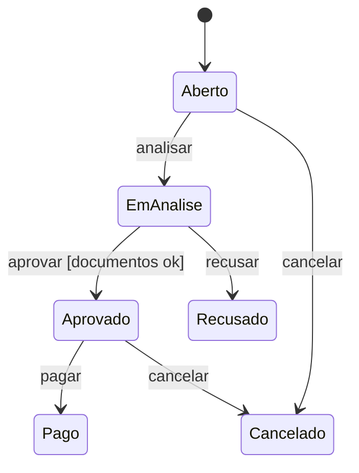

# Guia de teste do TestFlow

Como aplicar as técnicas e qual testware sai de cada uma (texto próprio do TestFlow, apoiado no syllabus CTFL 4.0). Leia quando o pedido for "completo", citar uma técnica, ou pedir plano, estratégia ou riscos. O formato dos documentos está em `CONVENCOES-QA.md`.

## 1. Testware por atividade

| Atividade | Pergunta | Testware no TestFlow |
| --- | --- | --- |
| Planejar | Como vamos testar e quando paramos? | Estratégia (time) · plano (épico/release) · registro de riscos · critérios de entrada/saída |
| Analisar | O que testar? | Revisão de requisito · condições de teste (lista na resposta ou na história) · exemplos na história · riscos novos |
| Modelar | Como testar? | Casos (com partições, tabela de decisão, modelo de estados) · cenários BDD · charter · massa no compartilhado |
| Implementar | O que precisa estar pronto? | Compartilhado (logins, massa por ambiente) · ciclo de regressão · ordem da rodada |
| Executar | Funcionou? | Execução (rodada) · bugs · evidências · teste em dupla · confirmação do bug |
| Acompanhar | Estamos no plano? | Resumo do período · `qa_rodada_status` · tendência |
| Concluir | O que aprendemos? | Relatórios de encerramento · retrospectiva · casos que viram regressão/automação |

## 2. Partição de equivalência e valor-limite

1. Para cada dado que a regra trata (campo, saída, configuração, data/hora, perfil), separe os grupos de valores que o sistema deveria tratar **do mesmo jeito**. Grupos não se sobrepõem.
2. Marque cada grupo como válido ou inválido. Um valor representativo por grupo basta.
3. Vários campos: cada grupo de cada campo aparece em pelo menos um caso ("cada escolha"); combine os **válidos** entre si à vontade, mas **um inválido por caso**.
4. Grupo com ordem (números, datas, tamanho de texto, quantidade): teste o limite. Padrão: o limite e o vizinho do outro lado (2 valores). Risco alto ou regra de dinheiro/prazo: o limite e os dois vizinhos (3 valores) — pega um `≤` trocado por `=`.
5. Declare a cobertura: "partições 5/5; limites 4/4 (2 valores)".

```markdown
## Partições e limites

| Campo | Grupo | Válido? | Representante | Limites (vizinho) |
| --- | --- | --- | --- | --- |
| Valor do Pix | 0,01 a 5.000,00 | sim | 150,00 | 0,01 (0,00) · 5.000,00 (5.000,01) |
| Valor do Pix | ≤ 0 | não | -10,00 | — |
| Valor do Pix | > 5.000,00 (limite noturno: 1.000,00) | não | 7.000,00 | — |
| Valor do Pix | texto/vazio | não | (vazio) | — |
```

Cada linha que vira execução entra na `## Iterações` do caso (`| Chave | valor | esperado |`), em vez de um caso por valor.

## 3. Tabela de decisão

1. Liste as **condições** (entradas que mudam o resultado) e as **ações** (o que o sistema faz).
2. Cada coluna é uma regra: uma combinação de condições e as ações que ela dispara. Use `S`/`N` (ou os valores, se a condição tiver mais de dois), `—` para "não importa", `n/a` para combinação impossível; nas ações, `X` = acontece.
3. Tire as combinações impossíveis e junte colunas em que uma condição não muda nada.
4. **Coluna sem resposta na história = lacuna; duas colunas iguais com ações diferentes = contradição** → leve para a revisão de requisito antes de escrever o caso.
5. Cada regra viável vira uma iteração (ou um caso, se os passos mudam). Cobertura: regras exercitadas ÷ regras viáveis. Muitas condições (5+): priorize as regras pelo risco e diga quais ficaram.

```markdown
## Tabela de decisão

| | R1 | R2 | R3 | R4 |
| --- | --- | --- | --- | --- |
| Cliente com cadastro completo | S | S | S | N |
| Valor acima do limite do horário | N | S | S | — |
| Tem limite extra aprovado | — | S | N | — |
| **Pix enviado** | X | X | | |
| **Pede confirmação por token** | | X | | |
| **Mensagem "limite excedido"** | | | X | |
| **Leva para completar o cadastro** | | | | X |
```

## 4. Transição de estados

1. Liste os estados da entidade e os eventos que a fazem mudar (com a condição, se houver: `evento [condição] / ação`).
2. Desenhe em `stateDiagram-v2` e monte a **tabela de estados** (linhas = estados, colunas = eventos, célula = estado seguinte; **vazia = transição inválida**). A tabela mostra o que o diagrama esconde: o que não pode acontecer.
3. Casos = sequências de eventos a partir do estado inicial. Escolha a cobertura pelo risco: **todos os estados** (mínimo, fraco) · **todas as transições válidas** (padrão) · **todas as transições**, inclusive tentar as inválidas (risco alto, dinheiro, segurança).
4. **Uma transição inválida por caso** (depois dela o estado fica incerto e esconde outros defeitos).

````text

````

| Estado \ evento | analisar | aprovar | recusar | pagar | cancelar |
| --- | --- | --- | --- | --- | --- |
| Aberto | Em análise | | | | Cancelado |
| Em análise | | Aprovado | Recusado | | |
| Aprovado | | | | Pago | Cancelado |

(células vazias = inválidas: ex. "pagar" em Aberto deve ser recusado com mensagem)

## 5. Ramos de um fluxo de regra

Quando a regra vier (ou couber) num fluxograma, desenhe em `flowchart` e garanta que **cada saída de cada decisão** é exercitada por algum caso. É a ideia da cobertura de ramos do código aplicada ao que o QA enxerga. Não gere casos de código-fonte: cobertura de instrução/ramo do código é do dev.

## 6. Suposição de erro e lista de ataques

Pense por categoria — entrada (formato, vazio, espaço, colar, caractere especial, tamanho), saída (formato, arredondamento, fuso), lógica (caso esquecido, operador trocado), cálculo, interface (outro sistema fora, lento, resposta inesperada), dados (registro antigo, duplicado, concorrência) — e pelos hábitos da tela (duplo clique, voltar, recarregar, duas abas, sessão expirada). A **lista de ataques da aplicação** (no arquivo de regras de geração) vem dos bugs dela: use-a antes da lista genérica.

## 7. Exploratório por sessão

Missão = área + recurso/técnica + que tipo de problema. Ligue a missão a um risco. Tempo fechado. No fim, **debriefing**: o que foi coberto, o que ficou, bugs e dúvidas, riscos novos e as próximas sessões. Pode usar as outras técnicas dentro da sessão.

## 8. Checklist

Itens em forma de pergunta, cada um verificável sozinho. Fora: o que a automação já verifica, critério de entrada/saída e itens vagos. Revise a lista pelos bugs (entra o que escapou, sai o que nunca mais falhou) e mantenha curta.

## 9. Critérios de aceite, exemplos e BDD

- Critério em cenário (Dado/Quando/Então) ou em regra (lista, tabela de entrada → saída) — os dois valem; converta quando o destino pedir (BDD → cenário; tabela de decisão → regra).
- **Mapa de exemplos** na história: por regra, exemplos que passam (✓), que não passam (✗) e perguntas (?). Pergunta sem resposta não vira caso, vira item da revisão.
- Cenário BDD declarativo (o que, não cliques), um comportamento por cenário, `Esquema do Cenário` com `Exemplos` tirados das partições/limites. Ordem: positivos, negativos, não funcionais. Nada fora da história.
- História boa: independente, negociável, valiosa, estimável, pequena e testável (INVEST). "Não sei como testar" é achado de revisão.

## 10. Planejar, estimar e priorizar

- **Estimativa de três pontos** por tarefa de teste: otimista (o), mais provável (m), pessimista (p); E = (o + 4m + p) ÷ 6, margem ± (p − o) ÷ 6. Some as tarefas.
- **Extrapolação**: com histórico, use a média das últimas rodadas parecidas (`qa_tendencia`, `qa_rodada_status`). Diga sempre que é estimativa e em que se apoia.
- **Ordem da rodada**: por risco (padrão), por requisito (o que o PO marcou como mais importante) ou por cobertura (o caso que cobre mais primeiro); depois ajuste por dependência (pré-requisito antes) e disponibilidade (ambiente, massa, pessoa).
- **Análise de impacto** antes da regressão de uma mudança/correção: o que a mudança toca (tela, serviço, regra, dado), quem mais usa isso, e só então a consulta da rodada.
- **Teste de manutenção**: migração ou troca de ambiente → teste de conversão dos dados e do ambiente novo; desativação → arquivamento e recuperação dos dados.

**Mapa de cobertura no plano** (`mindmap` do Mermaid): cada folha é uma condição de teste com a técnica (`Data futura - limites`). Escreva as folhas em texto simples e use ` - ` como separador — parênteses, colchetes e chaves viram o formato do nó (`((…))` = círculo).

## 11. Pirâmide e quadrantes (estratégia)

- **Pirâmide**: muitos testes pequenos e rápidos embaixo (unitário, do dev), menos de serviço/API no meio, poucos de ponta a ponta em cima (QA + Playwright). Caso E2E que testa uma validação de campo isolada está no andar errado.
- **Quadrantes**: Q1 técnico, guia o time (unitário, integração de componentes — automatizado, no CI) · Q2 negócio, guia o time (critérios de aceite, exemplos, BDD, API — manual ou automatizado) · Q3 negócio, critica o produto (exploratório, usabilidade, aceite do usuário — manual) · Q4 técnico, critica o produto (smoke, desempenho, segurança — ferramentas). Use para conferir se o plano tem os quatro.

## 12. Métricas e relatórios

- Famílias: progresso (executados, % sucesso, tempo), defeitos (por severidade, por fase, reabertos, **% de detecção** = achados antes de PROD ÷ total), risco (riscos altos ainda abertos = **risco residual**), cobertura (critérios, riscos, técnicas).
- **Progresso** (resumo do período): o que andou, desvios, impedimentos, riscos novos, próximo período. **Conclusão** (encerramento/resumo da release): resultado contra os critérios de saída, desvios do plano, riscos residuais, bugs abertos, lições aprendidas.
- Escreva para quem lê: o time quer detalhe; o PO e a gestão querem decisão e risco.

## 13. Defeitos

Uma anomalia relatada pode acabar sendo defeito, falso positivo, mudança de requisito ou duplicado — registre o desfecho no `## Andamento` do bug. Contexto mínimo: em que caso/execução/sessão apareceu, a fase (revisão, dupla, DEV, HML, PROD) e a técnica ou dado que a revelou.
