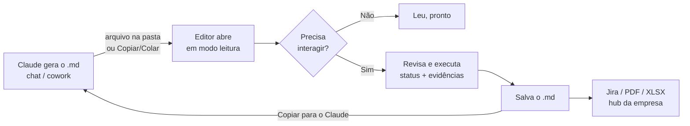

# TestFlow — Roadmap

> Levantamento de melhorias (sem implementação). Complementa o [PLANEJAMENTO.md](PLANEJAMENTO.md), que descreve o MVP.
> Última revisão: 29/09/2026 (Fase 9 planejada; respostas sobre Jira Cloud, PWA no Mac, evidências e planilhas — ver seção 5)

---

## 1. Contexto de uso (o que orienta as decisões)

| Fato | Consequência para o editor |
|---|---|
| **O grosso dos documentos é gerado pelo Claude** (chat / cowork), no Mac da empresa ou no Windows pessoal. | O editor é principalmente um lugar para **ler, revisar, ajustar e interagir** com Markdown gerado — não só para escrever do zero. |
| Documentos rápidos: basta olhar o Raw. Documentos **interativos** (resultado de teste, tabelas): hoje vão para o VS Code + extensão. | O ganho está nos documentos interativos: tabelas, status, execução, evidências. |
| Prefere **separar documentos de código** (VS Code fica para código). | Ferramenta própria, focada em documento, sem cara de IDE. |
| Referência de praticidade: **Quick Look do macOS (espaço)**. | Abrir um `.md` tem que ser instantâneo, com zero cerimônia, e abrir já em modo leitura. |
| **Duas plataformas**: macOS (empresa) e Windows (pessoal). | Tudo precisa funcionar igual nas duas. Nada que dependa de um SO só no núcleo. |
| **Local, sem anúncios, sem enviar dados** — vale ainda mais para documentos da empresa. | Zero requisições externas (já é assim hoje: sem CDN, sem telemetria). Funciona offline. |
| Os artefatos que mais saem do Claude são **`.md`, `.pdf` e `.xls`**. | O editor precisa **exportar PDF** e **conversar com planilhas** (tabela ↔ XLSX/CSV), não só Markdown. |
| O cowork salva em **uma pasta dentro de Documentos (Mac)** e na **raiz `C:\dev` (Windows)** — onde também ficam projetos de código e cursos. | "Pasta de trabalho" com esses caminhos como padrão, listando **só `.md`** e ignorando `node_modules`, `.git`, `dist` etc. |
| Bugs e testes no **Jira**; automação no **VS Code**. A empresa tem um **hub interno baseado em Markdown**, que no futuro deve receber os testes. | "Copiar para o Jira" confirmado. Compatibilidade com o hub reforça o princípio de **Markdown padrão (GFM)** — significado em badges/callouts, não só em cor. |
| Objetivo maior: **integrar as ferramentas** e trabalhar de forma homogênea. | Fluxo de ida e volta: **Claude gera → editor revisa/executa → resultado volta ao Claude** (ou segue para Jira/relatório). |

### Princípios

1. **Markdown puro é o formato.** Tudo o que o editor adiciona é convenção legível (front-matter YAML, badges em código inline, tabelas, `> [!NOTE]`). O arquivo continua bonito no GitHub, Azure DevOps Wiki, VS Code, Quick Look e — importante — no **hub de documentos da empresa**. Cor de texto (`<span style>`) é enfeite: pode sumir em outros visualizadores, então status e significado vão em **badges e callouts**.
2. **Claude e editor falam a mesma língua.** As convenções de QA ficam documentadas num arquivo que serve ao mesmo tempo de especificação do editor e de **skill do Claude**.
3. **Abrir rápido > ter muitos recursos.** Qualquer recurso novo não pode deixar a abertura mais lenta (carregamento sob demanda, como já é com o Mermaid).
4. **Nunca perder conteúdo** e **nunca reescrever o que não foi tocado** (regra do MVP, continua valendo).

---

## 2. O fluxo que queremos



---

## 3. Fases

Esforço: **P** = pequeno (horas) · **M** = médio (1–2 dias) · **G** = grande (vários dias).

### Fase 0 — Abrir tão fácil quanto o Quick Look *(base de tudo)*

| Item | Detalhe | Esforço |
|---|---|---|
| **App instalável (PWA)** ✅ feito (24/09) | "Instalar" pelo Chrome/Edge, no Mac e no Windows: ícone próprio, janela própria, funciona offline. Continua 100% local. | M |
| **Abrir `.md` com duplo clique / "Abrir com"** ✅ feito (24/09) | Registrar o editor como aplicativo para `.md` (File Handling API da PWA). No Windows e no macOS o arquivo abre direto no editor. | P (junto com a PWA) |
| **Abrir em modo leitura** ✅ feito (24/09) — ao abrir pelo sistema | Arquivo aberto de fora → Preview por padrão (como o Quick Look); um clique ou `Ctrl+E` para editar. | P |
| **Lembrar arquivos e recentes** ✅ feito (24/09) | Guardar os handles no IndexedDB: `Ctrl+S` salva no mesmo arquivo mesmo depois de reabrir; lista "Recentes". | P |
| **Recarregar quando o arquivo muda por fora** ✅ feito (24/09) | O cowork/Claude pode reescrever o arquivo enquanto ele está aberto → aviso "o arquivo mudou — recarregar?" (sem perder edições locais: oferece comparar). | M |
| **Pasta de trabalho** ✅ feito (24/09) | Abrir uma pasta e ver a lista de `.md` com busca. Padrões: **`~/Documents/<pasta do cowork>`** no Mac e **`C:\dev`** no Windows. Mostra só `.md`, ignora `node_modules`, `.git`, `dist`, `.venv`; agrupa por subpasta (projeto). Lembra as últimas pastas abertas. | M |
| ~~**Quick Look do macOS com o mesmo visual**~~ ❌ descartado (25/09) | Exigiria app nativo (Swift). O app instalado + "Abrir com" já resolve. | G |

### Fase 1 — Uso diário *(primeiro passo: colar imagem)*

| Item | Detalhe | Esforço |
|---|---|---|
| **Colar print (Ctrl+V)** ✅ feito (24/09) | Salva em `evidencias/` ao lado do `.md` (nome com data/hora, ex.: `2026-09-24_1530.png`) e insere ``. Funciona no Raw e no Preview. Sem pasta aberta: pergunta onde salvar uma vez. Opção de redimensionar e ver miniatura. | M |
| **Arrastar arquivos de evidência** ✅ feito (24/09) | Vídeo, HAR, PDF, log → copiados para `evidencias/` + link. | P |
| **Badges de status** ✅ feito (24/09) | `` `PASS` `` `` `FAIL` `` `` `BLOCKED` `` `` `SKIP` `` `` `N/A` `` coloridos automaticamente. | P |
| **Caixas de destaque** ✅ feito (24/09) | `> [!NOTE]` `[!TIP]` `[!WARNING]` `[!CAUTION]` `[!IMPORTANT]` (sintaxe GitHub). | P |
| **Colar tabela do Excel/Sheets** ✅ feito (24/09) | Vira tabela Markdown. | P |
| **Colar JSON/XML/log** ✅ feito (24/09) | Detecta, formata e cria o bloco com a linguagem certa; logs longos já recolhidos. | P |
| **Buscar e substituir** ✅ feito (24/09) | `Ctrl+F` / `Ctrl+H` no Raw e no Preview. | P |
| **Sumário lateral** ✅ feito (24/09) | Navegação por títulos. | P |
| **A−/A+ também no Raw** ✅ feito (24/09) | Mesmo ajuste de leitura do Preview. | P |
| **Exportar PDF** ⬆️ ✅ feito (24/09) | Subiu da Fase 6: PDF é um dos 3 formatos mais usados. Layout de impressão limpo (sem toolbar), quebras de página que não cortam tabelas, cabeçalho com título/data, diagramas Mermaid incluídos. | P |
| **Tabela ↔ planilha** ⬆️ ✅ feito (24/09) | Botão no bloco de tabela: **exportar para XLSX/CSV**. E o inverso: **importar XLSX/CSV** (arrastar o arquivo) → tabela Markdown. A biblioteca de planilha só carrega quando usada, para não pesar a abertura. | M |

### Fase 2 — Convenção QA-MD + skill do Claude *(integração com a sua rotina)*

O ponto que mais alavanca o resto: **o Claude já gerar no formato que o editor entende.**

| Item | Detalhe | Esforço |
|---|---|---|
| **`CONVENCOES-QA.md`** ✅ feito (24/09) | Especificação curta: front-matter (id, status, prioridade, severidade, ambiente, browser, versão, tags), badges de status, tabela de passos (`# | Ação | Esperado | Obtido | Status`), seção de evidências, callouts. Tudo Markdown padrão. | P |
| **Skill do Claude "QA Markdown"** ✅ feito (24/09) | O mesmo conteúdo vira uma skill instalada no Claude da empresa (Mac) e no pessoal (Windows). Ao pedir "gera o caso de teste de X", o documento já sai pronto para ser interativo no editor. | P |
| **Modelos (templates)** ✅ feito (24/09) | Caso de Teste, Cenário/BDD, Plano de Teste, Bug Report, Relatório de Execução, Charter Exploratório, Checklist de Regressão, Resumo de Testes. **Mesmos modelos** no editor (`/testcase`, `/bug`…) e na skill. | M |
| **Comando `/`** ✅ feito (24/09) | Menu rápido no Preview/Raw para inserir modelos e blocos. | M |
| **Cartão de metadados** ✅ feito (24/09) | O front-matter aparece como cabeçalho visual com badges; editável por formulário. | M |
| **Lint de QA** ✅ feito (24/09) | Avisos: caso sem resultado esperado, passo sem status, ID duplicado, evidência inexistente, link quebrado. Útil também para revisar o que o Claude gerou. | M |

### Fase 3 — Documentos interativos *(a dor principal: resultado de teste)* ✅

| Item | Detalhe | Esforço |
|---|---|---|
| **Tabela de passos interativa** ✅ feito (24/09) | Clique na célula da coluna Status → seletor PASS/FAIL/BLOCKED/SKIP/PENDING (teclas 1–5, o seletor desce para a próxima linha). Grava só aquela célula; o `status:` do cabeçalho é recalculado (algum FAIL → FAIL; senão BLOCKED; senão PENDING; senão PASS). | M |
| **Editor de tabela visual** ✅ feito (24/09) | Barra na tabela em edição: inserir/excluir/mover linhas e colunas; `Tab`/`Shift+Tab` entre células (Tab na última cria linha), `Enter` desce, `Shift+Enter` quebra linha na célula (`<br>`), colar várias células do Excel preenche a partir da célula atual. `|` digitado vira `\|`. | G |
| **Progresso e resumo automáticos** ✅ feito (24/09) | Barra **Execução** no topo do Preview (status geral, progresso, contagem por status). Bloco `<!-- qa:resumo -->` com tabela + gráfico Mermaid `pie` (funciona no GitHub), recalculado ao mudar status, ao salvar e pelo botão 📊. | M |
| **Checklists com contador** ✅ feito (24/09) | "12/20 ✓" ao lado de cada título de seção; chip ☑ na barra. | P |
| **Filtro por status** ✅ feito (24/09) | Clique num chip da barra (FAIL, BLOCKED…) para ver só essas linhas; ☑ mostra só os itens não marcados. | P |

### Fase 4 — Execução ✅

| Item | Detalhe | Esforço |
|---|---|---|
| **Modo execução** ✅ feito (24/09) | **▶ Executar** abre um painel que percorre os passos: ação e esperado à vista, obtido digitado, status com 1–5 (avança sozinho), `Ctrl+V` cola o print do passo em Evidências ("Passo 3 — …"). **Concluir** registra a rodada (data, início, fim, duração, ambiente, resultado, responsável) em `## Histórico de execuções`. | G |
| **Teste exploratório (SBTM)** ✅ feito (24/09) | **⏱ Sessão** (documentos `charter-exploratorio` ou menu `/`): cronômetro com pausa, notas rápidas NOTA/BUG/DÚVIDA/IDEIA com horário (BUG também entra na tabela de Bugs); ao encerrar preenche Início/Fim/Real e uma linha de resumo. | M |
| **Anotar print** ✅ feito (24/09) | Ao colar um print abre o editor: seta, retângulo, texto, **borrar** (mosaico gravado no arquivo — LGPD), cores, desfazer; Enter salva, "Sem anotação" mantém o original, opção para não abrir automaticamente. Prints já no documento: botão **✎** no bloco. | G |
| **Re-execução** ✅ feito (24/09) | **🔁 Nova rodada** copia a tabela atual para o Histórico ("### Rodada N — data — resultado") e limpa obtido/status; cabeçalho volta a PENDING. O histórico não conta na barra, no resumo nem na validação. | P |

### Fase 5 — Resultados de automação ✅

| Item | Detalhe | Esforço |
|---|---|---|
| **Importar JUnit XML** ✅ feito (24/09) | Arrastar o `.xml` (ou `/importar resultados`) → relatório `relatorio-execucao` com resumo + gráfico, tabela de resultados e seção de falhas (mensagem em destaque, stack trace recolhido, anexos `[[ATTACHMENT|…]]`). `Shift` ao soltar insere no documento aberto. | M |
| **Playwright JSON / Newman JSON** ✅ feito (24/09) | Playwright: projeto (browser), duração, retries, **flaky**, screenshot/trace/vídeo como links. Newman: requisição, método/URL, HTTP, asserções que falharam. | M |
| **Vincular caso manual ↔ teste automatizado** ✅ feito (24/09) | ID no nome do teste (`TC-042 …`, `@TC-042`) ou `automacao:` do caso (pasta de trabalho) = spec → coluna **Caso** e seção **Cobertura dos casos manuais**. Arquivo do teste, anexos e o `automacao:` do cartão abrem no VS Code (`vscode://file/…:linha`); caminhos relativos usam a pasta do projeto de automação (perguntada uma vez). | M |

### Fase 6 — Devolver e compartilhar *(fecha o ciclo)* ✅

| Item | Detalhe | Esforço |
|---|---|---|
| **Copiar para o Claude** ✅ feito (25/09) | Menu **▾** no *Copiar tudo*: falhas (com pedido de análise/bug report), resumo da execução (status report) e documento + instruções do formato. | P |
| **Copiar para o Jira** ✅ feito (25/09) | Blocos selecionados ou documento (cabeçalho vira título + campos). Copia texto formatado (editor visual do Jira Cloud/Data Center) e *wiki markup* (modo Texto do Jira Server/Data Center) de uma vez. Status em cor, alertas viram painéis, prints listados para anexar (`!arquivo.png!` no wiki). Sem API, sem login. | M |
| **Mascarar dados sensíveis** ✅ feito (25/09) | Antes de copiar/exportar: CPF, CNPJ, e-mail, telefone, cartão, senhas, tokens, senha em URL. Lista para desmarcar dado de teste; máscara legível (`529.•••.•••-25`); para o Claude, marcadores `{{EMAIL_1}}` que voltam ao aplicar a resposta. Também "mascarar no documento" e preferência Perguntar / Mascarar sempre / Não verificar. | M |
| **Exportar HTML** ✅ feito (25/09) | Página única com o visual do Preview, estilos e imagens embutidos (o PDF subiu para a Fase 1). | P |
| **Notion (sem API)** ✅ feito (25/09) | Copiar para o Notion (Markdown ajustado para colar numa página) e pacote `.zip` (Markdown + prints) para *Importar → Texto e Markdown*. Tudo local; dados sensíveis verificados antes. | P |
| ~~**Publicar no hub da empresa**~~ ❌ descartado (25/09) | O `.md` já é o formato do hub; copiar/exportar basta. | ? |
| ~~**Integração Jira por API**~~ ❌ descartado (25/09) | Copiar para o Jira resolve. | G |

### Fase 7 — Plataforma ✅ *(concluída)*

| Item | Detalhe | Esforço |
|---|---|---|
| **Abas e links entre documentos** ✅ feito (25/09) | Abas com desfazer próprio e restauradas ao reabrir; `[[TC-042]]` vira link; aba **Links** com "Citado em" (links e menções do ID) e links de saída. | M |
| **Paleta de comandos** ✅ feito (25/09) | `Ctrl+Shift+P` (o `Ctrl+P` continua sendo PDF): ações, arquivos da pasta, recentes, abas, títulos e blocos. | M |
| **Raw com CodeMirror 6** ✅ feito (26/09) | Numeração, destaque de Markdown (e do código dos blocos), status coloridos, várias seleções, mover linha, recolher seções, destaque da busca. O resto do editor continua falando com o Raw como se fosse um textarea (comandos, colar, `/`, busca, abas). | M |
| **Testes automatizados do editor** ✅ feito (25/09) | `npm test` (regras, test runner do Node, sem dependências) e `npm run test:e2e` (fluxos da tela com Playwright). | P |
| **TypeScript gradual** ✅ feito (26–28/09) | **Fase 1 ✅:** `tsc` verifica (sem mudar o build) os 14 módulos de regras — status, execução, busca, painel, dados sensíveis, Jira, Notion, revisão, cópias, cabeçalho, índice da pasta — com `strict`; tipos do domínio em `src/types.d.ts`; `npm run check`. Achou e corrigiu pontos que podiam quebrar com dado inesperado (seção inexistente, regex sem resultado). **Fase 2 ✅:** todo o `src` (interface, editor, arquivos, `main.js`) passa por uma verificação "branda" (`tsconfig.app.json`): nomes de propriedade/método, argumentos, opções documentadas e tipos dos elementos da tela; declarações do ambiente em `src/env.d.ts` (Vite, File System Access, painel flutuante, o Raw como `RawEditorElement`). Achou opções usadas mas não documentadas (`setSource`, `wide`, `startIn`, `onAutoOpenChange`) e tipos soltos no CodeMirror. **Fase 3 ✅ (27/09):** os 13 módulos de regras viraram `.ts` de verdade (`src/markdown/*.ts` e `src/io/docIndex.ts`) com `strict` completo (inclusive `noImplicitAny`): tipos explícitos em todas as funções exportadas (`StatusTable`, `StepTable`, `Section`, `FrontMatterEntry`, `DiffPart`, `JiraCopy`…); plugins do markdown-it com os tipos do próprio pacote. O Vite compila os `.ts` direto; `npm test` roda com `tsx`. Não muda nada na tela. **Fase 4 🟡 (27/09):** modo rigoroso ligado (`// @ts-check` + JSDoc) em 56 de 57 arquivos (82% das linhas): núcleo (store, desfazer), arquivos e pasta de trabalho, evidências, planilhas, automação, parser/lint/sanitizador/turndown, Raw (CodeMirror), busca, abas, menus, painel, dados sensíveis, revisão, execução e editor de tabela. Tipos novos compartilhados: `Toast`, `PrefsApi`, `AutomationResult`, `ParsedBlock`, `CommandItem`, `TabSnapshot`; tipos do turndown (`@types/turndown`). Segunda rodada: anotar print, barra lateral, seleção de blocos, comandos da toolbar, painel de execução/sessão e o Preview (estado de edição tipado: visual × Markdown). Terceira rodada (28/09): o `main.js` — **fase 4 concluída, 100% do `src` no modo rigoroso**. Configuração simplificada: um só `tsconfig.json` com `checkJs` (arquivo novo já é verificado); o `tsconfig.app.json` e o `npm run check:progress` saíram. Pontos protegidos: print inserido em bloco Markdown sem seleção guardada, aba restaurada sem nome, resultado de busca sem arquivo, renomear arquivo numa subpasta sem acesso. | M |

---

### Ajustes de uso (25/09) ✅

Topo redesenhado em grupos (Novo ▾, Abrir, Salvar ▾, Copiar ▾, PDF), toolbar em grupos com rolagem horizontal, dica na barra de status; renomear o arquivo pelo nome no topo; arquivos da pasta de trabalho em árvore; pastas de trabalho recentes; duplo clique / **+** para criar bloco no Preview; print colado depois de limpar o texto do bloco vai para o lugar certo.

### Revisar com o Claude ✅ feito (25/09)

Ida e volta pela área de transferência (sem chave de API, nada sai do editor sozinho): pedido montado (blocos selecionados, bloco atual, linhas do Raw ou documento; ortografia, clareza, tom, padrão QA-MD, pedido extra) → resposta colada → **antes × depois** por palavra → aplicar (`Ctrl+Z` desfaz). Funciona com qualquer IA de chat.

### Bloco de código na toolbar ✅ feito (25/09)

**{ } Código ▾** com linguagens (a última vira padrão), `Ctrl+Alt+K`, abre já para digitar no Preview e envolve blocos/texto selecionados.

### Ajustes (26/09 — noite) ✅

**1.1.2 (30/09):** Pergunta do usuário (pasta do Mac organizada na versão antiga): o editor não avisava da `requisitos/` nova — o botão de organizar só aparecia em pasta sem estrutura, e *Criar estrutura* só criava subpastas de aplicações novas. Agora *Criar estrutura* completa as aplicações existentes e a árvore mostra **🗂 Completar a estrutura…** (dispensável) quando falta subpasta.

**1.2.0 (30/09):** Pedido do uso real (muitos casos por ticket): **⏭ Próximo caso da pasta** ao terminar um caso — pelo ✓ Concluir do modo execução ou marcando o último passo à mão — com botão na barra Execução, paleta e `Alt+Shift+→` (prefere não executados, ordem natural do nome, dá a volta; caso do ciclo ativo segue o ciclo). **Pasta por ticket** em `casos/`: `suggestDestination` usa a chave do `jira:` (`casos/<TICKET>/`, reaproveitando pasta que começa com a chave), *Novo documento aqui* numa pasta de ticket preenche `jira:`, o MCP (`qa_criar`) faz o mesmo e **🎫 Organizar casos por ticket…** move os soltos de uma vez (com Desfazer).

**1.2.1 (01/10):** Bug do uso real: `[[link]]` digitado no Preview (célula de tabela, parágrafo com texto) saía escapado pelo turndown (`\[\[TC-3\]\]`) e não virava link. `toMarkdown.js` desfaz o escape de `[[…]]`; teste `wikiedit.spec.mjs`.

**1.3.0 (01/10):** Pedidos do uso real: (1) `[[` abre a lista dos documentos (Raw, Preview, células de tabela; `linkPicker.js`) e `/` → *Link para documento*; (2) cabeçalho → corpo: `syncHeaderToBody` (id/titulo) no cartão do Preview e no Ctrl+S; (3) **identidade fixa `uid:`** (`idRename.ts`): o link continua legível (`[[SES-005]]`), e ao trocar o ID o Ctrl+S reescreve os `[[links]]` dos outros documentos (`organizer.relinkIds`, com Desfazer), renomeia o arquivo que começava com o código antigo e, pelo mapa uid→id guardado, reconhece trocas feitas fora do editor; o MCP faz o mesmo em `qa_atualizar_cabecalho`; autosave espera o Ctrl+S quando o código muda; (4) *Copiar para o Jira* sem o cabeçalho; (5) painel **🖼 Evidências** (copiar imagem, baixar, .zip, copiar caminho completo — a raiz da pasta no computador é informada uma vez); (6) **📍 de onde é o documento** no rodapé (pasta de trabalho, outra pasta conhecida ou avulso) + marca ↗ na aba; (7) árvore: seta SVG maior, recolher a pasta do arquivo aberto; (8) Recentes recolhível.

**1.4.0 (01/10):** Pedido do uso real: **⬇ Atualizar a pasta de trabalho com a oficial** de uma vez (`updateAllFromOfficial` em collab.js; plano em `officialSync.ts`: seguros = cópia local igual à publicada; alterados por você = só com confirmação; novos = só na oficial; abertos sem salvar ficam de fora). Versão local vai para `.versoes/`; um diário com Desfazer (`organizer.remember` agora recarrega as abas ao desfazer). Botão ao lado de 🏛 Oficial + paleta; o antigo *Trazer tudo* do menu 🏛 usa o mesmo fluxo.

**Modo de execução de testes — plano revisado (05/10, com a especificação completa):**
- ✅ Etapa 1 (1.7.0) e etapa 2 (1.8.0): seleção, checklist lateral, concluir→próximo, revisão sem perder estado, Finalizar execução com SKIP automático, "Como foi essa rodada?".
- ✅ **Etapa 3 (feita na 1.9.0) — Ciclo × Execução:** o *ciclo* vira a definição salva (lista de casos, sem estado); cada *execução* é um documento próprio ligado ao ciclo (`ciclo: [[Regressão 2.5]]`), com o ciclo mostrando a tabela de execuções (#, data, % PASS). **Executar este ciclo de novo** cria a execução #N; rodada avulsa (sem ciclo); ciclos antigos continuam abrindo como execução avulsa. Inclui **Pular caso** (SKIP manual na checklist) e comentários/evidências de PASS e SKIP no resumo.
- ✅ **Etapa 4 (feita na 1.10.0) — Vínculos extensíveis:** campos no cabeçalho (`jira:`, `epico:`, `sprint:`…) por um registro de tipos de vínculo, para novos tipos entrarem sem refazer a execução.
- ✅ **Etapa 5 (feita na 1.11.0) — Relatório Playwright na execução:** anexar/importar o relatório (reaproveita o importador de JUnit/Playwright JSON/Newman, seção 9 do manual) como extra "Testes automatizados" ao lado dos manuais; execução só manual, só automatizada ou mista; deixar espaço para ligar teste automatizado ↔ caso pelo ID (a coluna **Caso** já existe no relatório).

✅ **Feito na 1.12.0 — Dispositivo/ambiente:** substituir/expandir o campo atual *Browser* por **Dispositivo/Ambiente**: WEB, Mobile iOS, Mobile Android, Mobile — Todos; para mobile informar a versão (ex.: Mobile iOS — iOS 18, Mobile Android — Android 15). Deve aparecer nas tags, no cabeçalho do caso, nos modelos de criação de casos e nas informações da execução, para rastrear em que dispositivo/plataforma cada caso foi validado.

**1.27.0 (09/10) — 10.3, parte 4: menu Novo e paleta.** Menu Novo com `.menu-title` Documento/Execução/Importar e o comando novo `newCase` (modelo caso-de-teste). Paleta: `PALETTE_GROUPS` (categoria + ícone por comando, na ordem das categorias; o resto em "Ações") e `paletteRecent` (6 últimas ações escolhidas, no grupo "Usados recentemente").

**1.26.0 (09/10) — 10.3, parte 3: tela inicial.** `src/app/home.js` (`createHome`): seção `#home` sobre a área do documento (a barra lateral fica à mostra; runner, painel da rodada e barra de formatação esperam), mostrada quando só o exemplo está aberto (`maybeHome`) e pelo logo/paleta (`home`); some em `loadDocument`. Conteúdo: rodada em andamento (a ativa ou a mais recente aberta; ▶ Continuar = abre a execução + `nextCycleCase`), pendências (FAIL, BLOCKED, `execState` nunca, bugs abertos → `sidebar.focusSearch`), atalhos e fixados/recentes; redesenha ao terminar de ler a pasta. Preferência `home` (os testes de tela desligam em `helpers.mjs`; `interface3.spec` testa).

**1.25.0 (08/10) — 10.3, parte 2: menos barras e modo foco.** `src/app/chrome.js`: no Preview (preferência `toolbarMode: auto|sempre`), a `#toolbar` vira `position:absolute` sobre a coluna do documento (`--tb-top`/`--tb-left`) e só aparece com bloco em edição/selecionado, foco ou menu aberto; o bloco em edição é rolado para não ficar sob ela. Modo foco (`Ctrl+Shift+.`, `focusMode` lembrado, botão ⤢). Barra de execução numa linha: sem os chips zerados e sem o rótulo "Execução"; "📊 Resumo".

**1.24.0 (08/10) — 10.3, parte 1: árvore e avisos.** Árvore com **ID · título** e bolinha de status (`treeLabel` em `src/app/docState.js`, opção `label` do `createSidebar`; preferência `treeLabels: titulo|arquivo`, comando na paleta; os testes de tela usam `arquivo` por padrão em `helpers.mjs`); dica do arquivo com ID — título (status) + caminho; árvore redesenha ao salvar (status muda). Recentes recolhe sozinho com pasta aberta até o usuário escolher. Sem os avisos "Aberto: …" e "Pasta de trabalho: …" (fica só o "de volta onde você parou"); dica do rodapé só nas 5 primeiras sessões (`hintSessions`).

**1.23.0 (08/10) — escopo dos casos e varredura de vínculos** (pedido do Lucas). Skill `qa-markdown` §6.0 *Nível, tipo e profundidade* (e2e/API/unitário/negócio · smoke/sanity/regressão/funcional/exploratório/não funcional · enxuto/padrão/completo com técnicas ISTQB; padrão = caixa-preta do QA, sem backend/unitário, premissa declarada, tags de nível/tipo) — também em `CONVENCOES-QA.md` §8 (o `qa_convencoes` do MCP entrega). `src/markdown/sweep.ts` (`sweepLinks`, `applySweep`, `sweepReport`): achados com confiança certo/provável/confirmar; MCP `qa_varredura` (relata; `aplicar: certo|provavel` só preenche vazios e soma tags) e `qa_ligar`; skill nova `qa-varredura` (`scripts/skill-varredura.md`, gerada por `npm run skill`).

**1.22.0 (08/10) — Fase 10.4: Claude no fluxo do QA.** MCP (`mcp/qa.ts`, `mcp/server.ts`): `qa_rodada_status`, `qa_rodada_criar` (segmento/consulta/casos — interseção — ou ciclo salvo → execução #N; herança via `commonHeader`/`headerOf`; `runDestination`), `qa_rodada_registrar` (passos no caso com `needsFreshRound`→`newRound` e `logRun` quando todos marcados; ou status do caso inteiro na execução; observação vira comentário), `qa_rodada_finalizar` (`skipPending`+`closeCycle`, atualiza a tabela Execuções do ciclo, relatórios), `qa_relatorios` (`buildReports`/`linkReports`, aceite lido do disco), `qa_validar` (lint + `findBrokenLinks` + evidência faltando + cabeçalho), `qa_rastreabilidade` (visão `formato: rastreabilidade` + `segmento:`); `qa_bug_do_caso` com `reincidencia`/`novo`/`execucao`. Skill: §6.1 do requisito ao caso, §6.2 checklist de revisão, §6.3 analisar a rodada; herança na §Como entregar.

**1.21.0 (08/10) — segmentos, herança e pasta do épico** (pedido do Lucas depois da 1.20.0). `src/markdown/segment.ts`: `segmentMembers(chave, docs)` (direto por ID/campo/tag/pasta → tickets das histórias do épico → o que a raiz cita → quem cita ou nasceu de um membro), `commonHeader` (o que todos os casos escolhidos têm), `inheritHeader` (soma tags, preenche campos vazios). Busca/visões/MCP: filtro `segmento:` (`seg:`); árvore: 🧩 Reunir o segmento. Estrutura: épico em `casos/<ÉPICO>/`, ticket com épico em `casos/<ÉPICO>/<TICKET>/` (`ticketDir`, `segmentOfDir`, `epicKey`), `ticketMoves` → *Organizar por épico e ticket*. Herança: pasta → caso novo (app e MCP), casos → execução/ciclo, ciclo → execução (tags), execução → relatórios, caso → bug (`origin` execução/ciclo; sem jira). `describe` ganhou `origem` (ciclo/execucao/plano).

**1.20.0 (08/10) — Fase 10.2: relatórios de fim de execução.** `src/markdown/reports.ts` (puro, para o app e o MCP): `buildReports(execPath, docs)` monta os 4 documentos (`relatorio-encerramento`, `-defeitos`, `-rastreabilidade`, `-log`) em `<pasta da execução>/relatorios/<EXEC-ID>/`; `linkReports` põe a seção *Relatórios* na execução; `keepManual` preserva os trechos `<!-- qa:manual:nome -->` ao regerar (lidos do disco). Critérios de saída em texto livre avaliados por `evalCriterion` (bugs por severidade, % executado, % sucesso, BLOCKED); plano pelo vínculo novo `plano:` ou pelo que cita mais casos. App: `src/app/reports.js` (🏁 Finalizar gera; **📑 Relatórios** no painel e na paleta regera).

**1.19.1 (08/10) — Fase 10.1.** Cenário BDD executável na rodada (`collectStatusTables` aceita a tabela *Cenário | Status* vazia); "em andamento" só para caso que começou nesta rodada (`cycleStarted` ou rodada antiga arquivada num dia da rodada) e **último resultado** em cinza nos pendentes (`lastResultBefore`); rodada/ciclo nascem junto das execuções existentes ou numa `execucoes/` (`runDestination`, também no `qa_criar` do MCP).

**1.19.0 (08/10) — novo nome: TestFlow.** Nome visível (`branding.json`: name/shortName/description, manifesto do PWA, título, manual, documentos, skill, extensão do Claude `testflow.mcpb` com display_name *TestFlow*) e ícone novo (✓ que vira seta, `public/icons/`, logo do topo em SVG). Identificadores internos mantidos de propósito (dados e extensão não se perdem): `mdqa:*`, IndexedDB `md-qa-editor`, ids `mdqa-*` dos seletores de pasta, id do MCP `markdown-qa`, skill `qa-markdown`, formato QA-MD. Repositório: `testflow` (privado).

**1.18.3 (07/10) — rodada com casos que já têm histórico:** o ✓ Concluir rolava até o *Histórico de execuções* e, na rodada, a aba fechava ali — a posição lembrada (1.16) ficava no histórico e era restaurada por cima da execução do próximo caso. Agora: `finishExec` só rola ao histórico se ninguém tratou o fim (`onFinish` devolve true no ciclo), `applyPos` não mexe na tela se a execução já começou, e o primeiro destaque do passo centraliza (`centerNext`, de novo depois de 2 frames). Teste: `rodadaHistorico.spec.mjs`.

**1.18.2 (07/10) — uso real numa rodada:** (1) o "+" do bloco ficava embaixo da alça ⋮⋮ (mesma posição, -22px) → grupo `.block-gutter` com **+ ⋮⋮** lado a lado na margem (`#preview` com padding-left 58px), o "+" do grupo aciona o do bloco; Alt+clique cria acima (`preview.newBlockBefore`). (2) destaque num bloco novo vazio: o bloco era descartado e o comando trocava a linha em branco entre blocos (`> [!NOTE]\n> ` grudado no seguinte) e o cursor ficava no título não editável → `formatCommand` trata posição vazia como bloco novo (`insertBlockAfterActive` + `editAtLine`), `editAtLine` ignora o que é `contenteditable=false`, `caretOutOfReadonly` + `selectionchange` tiram o cursor do título, `ensureAlertBody` dá um parágrafo à caixa só com título. Teste: `blocos2.spec.mjs`.

**1.18.1 (07/10) — lentidão no Mac (pasta em disco de nuvem):** varredura da pasta em paralelo (8 listagens; `scanWorkspace` com progresso e `stats`), árvore não some mais na releitura ao voltar para a janela (`setWorkspace` mantém a lista), leituras sobrepostas viram uma (`loadWorkspaceFiles` com fila única / `ifStale`), clique repetido no mesmo arquivo não abre de novo e entre arquivos diferentes vale o último (`openFromHandle` `latest`), clique na árvore pelo caminho (`data-ws-path`), sem `indexOf` por linha. Ctrl+Shift+P → *Diagnóstico: tempo para ler a pasta*. Não reproduzido aqui em disco local (206 e 800 docs abrem em < 0,4 s); simulado com disco lento em `discoLento.spec.mjs` (3,4 s → 1,35 s). Aguardando o diagnóstico do Mac.

**1.18.0 (07/10) — QoL, fim do backlog:** **reabrir bug** (reincidência registrada no bug já ligado, com print; fechado volta a FAIL), **backup** da pasta de trabalho em .zip com **lembrete** (7 dias por padrão, só se mudou; adia um dia) e **ida e volta no Jira** coberta por testes (`jiraRoundtrip.test.mjs`) + roteiro manual. Testes: `qol118.test.mjs`, `qol118.spec.mjs`. Pendente fora do backlog: confirmar com o outro QA Google Drive ou pasta de rede.

**1.17.0 (07/10) — QoL:** **★ fixados** no topo da árvore (por pasta de trabalho, acompanham mover/renomear); **busca com filtros** (`status:` `tag:` `jira:` `tipo:` `app:` `execucao:`… com a mesma regra das visões; `-tag:x` exclui; só filtro lista documentos; atalhos prontos); **resumo da rodada** para Jira/Slack/e-mail/Markdown com bugs abertos. Correção: o menu do clique direito na árvore fechava sozinho quando o item estava cortado na borda (a rolagem automática do navegador fechava o menu). Testes: `searchFilters.test.mjs`, `roundShare.test.mjs`, `qol117.spec.mjs`.

**1.16.0 (07/10) — QoL:** **print grande** (> 2 MB) ao colar/soltar/capturar: diálogo *Reduzir* (PNG até 1920 px; se ainda passar de 2 MB, JPEG 85 %) ou *Manter original*, com *Fazer sempre assim* (pref `bigPrint`: ask/reduce/keep; painel flutuante não pergunta). **Voltar onde parou:** abas restauradas ao recarregar já voltam com cursor e rolagem (`rawTop/previewTop/sel` em `mdqa:tabs`) e arquivo reaberto depois de fechar a aba volta ao ponto (`mdqa:pos`). Tema por horário/sistema descartado. Testes: `qol116.spec.mjs`.

**1.15.0 (06/10) — mover blocos arrastando (estilo Notion):** alça **⋮⋮** à esquerda do bloco no Preview (`src/editor/blockSelect.js`): arrastar mostra a linha azul de destino e move o bloco ou a seleção inteira; título recolhido leva a seção escondida; clique abre menu (mover ↑/↓, duplicar, copiar Markdown, apagar). YAML e comentários não têm alça; na margem a alça não surge (lá continua o retângulo de seleção). Lista/tabela move inteira (é um bloco só). Só mouse (sem toque). Teste: `moverBloco.spec.mjs`.

**1.14.0 (06/10) — documentos "como um todo" no ciclo:** checklist (ou outro .md sem tabela de passos) numa rodada aparece como **🗒 como um todo** no seletor; no painel, `n/m itens marcados` + ✅/❌/⛔ registram o documento inteiro (`applyWhole` em `cycle.ts`, pref `cycleWhole`, `markWhole` em `app/cycle.js`). ⏭ pula; finalizar marca SKIP o que não foi registrado. Testes: `cycleAuto.test.mjs`, `cicloTodo.spec.mjs`.

**1.13.0 (06/10) — prints e árvore:** editor de anotação com numeração ①②③, marca-texto, recorte, alças, tamanho do texto, zoom e Ctrl+D; **reedição** (original + marcações em `evidencias/.anotacoes/`, só sem borrão); botão ⊟/⊞ para recolher/abrir todas as pastas da árvore (`toggleAllFolders` em `sidebar.js`). Testes: `anotacao2.spec.mjs`, `arvore.spec.mjs`. Limite: mover/renomear o print por fora perde a reedição.

**1.12.0 (06/10) — item 12 do prompt (Dispositivo/ambiente):** novo campo `dispositivo:` (WEB, Mobile iOS, Mobile Android, Mobile — Todos; versão nos mobile, ex.: `Mobile iOS — iOS 18`), registro `DEVICE_KINDS` em `src/markdown/device.ts` (`parseDevice`, `formatDevice`, `setDevice` com as tags `web`/`mobile`/`ios`/`android`); janela `src/ui/deviceDialog.js`, botão 📱 no painel da execução e comando *Dispositivo / ambiente…*; chip no painel e no resumo; a execução herda o do ciclo; modelos (caso, bug, charter, relatório) trazem o campo; `lastEnv` repete na próxima execução; Jira/CSV/compartilhar mostram; visões filtram por `dispositivo:`. `browser:` continua (navegador do WEB). Testes: `device.test.mjs`, `dispositivo.spec.mjs`. **Com isso, todos os 13 itens do prompt estão atendidos.**

**1.11.0 (06/10) — modo de execução de testes, etapa 5:** **relatório automatizado na execução** — `🤖 Relatório automatizado` (painel / paleta) anexa Playwright JSON, JUnit XML ou Newman JSON como seção `## Testes automatizados` da execução (`src/markdown/cycleAuto.ts`: `autoSummary`, `setAutoSection`; bloco gerado por `buildAutomationBlock` em `automationReport.js`, reaproveitando `buildAutomationSections`). A tabela usa a coluna *Resultado* (não *Status*), então não entra na contagem/% dos manuais; o painel e o "Como foi essa rodada?" têm bloco 🤖 próprio; o status geral soma manual + automatizado (`overallOf`); anexar de novo troca; execução já encerrada refaz o *Encerramento* (`attachAutomation` em `cycle.ts`). **Novo ▾ → 🤖 Execução só automatizada…** cria a execução sem casos manuais (só manual, só automatizada ou mista). Espaço para o casamento teste ↔ caso: `autoSummary().casos` lista os IDs citados nos testes e a coluna *Caso*/*Cobertura dos casos manuais* já existem — **sem** casar automaticamente nem mudar o status do caso manual (de propósito, 1ª versão). Testes: `cycleAuto.test.mjs`, `automatizado.spec.mjs`. **Falta:** só o item 12 (Dispositivo/ambiente) do prompt, ainda TODO.

**1.10.0 (06/10) — modo de execução de testes, etapa 4:** **vínculos extensíveis** — registro `LINK_TYPES` em `src/markdown/linkTypes.ts` (Jira, Épico, Sprint; novo tipo = uma linha), gravados no cabeçalho (`jira:`, `epico:`, `sprint:`); janela `src/ui/linksDialog.js` (também na seleção dos casos), herança do ciclo para a execução, chips no painel e no resumo, comando *Vínculos…*, filtros `sprint:`/`epico:` nas visões. Testes: `linkTypes.test.mjs`, `ciclo.spec.mjs`. O teste "O que mudou" agora lê o próprio changelog (não quebra mais a cada versão). **Falta:** etapa 5 (relatório Playwright anexado à execução; manual + automatizado; só automatizado).

**1.9.0 (06/10) — modo de execução de testes, etapa 3:** **ciclo × execução** — o ciclo (`tipo: ciclo-regressao`, sem `inicio`) é a definição salva com a tabela *Execuções* (#, início, fim, resultado, % sucesso); cada execução é um documento `tipo: execucao` com `ciclo:` e `numero:`; ciclos antigos (com `inicio`) seguem como rodada avulsa. Novo ▾: 🔁 Ciclo de regressão (salvar), ▶ Rodada de execução (avulsa), ▶ Executar um ciclo salvo; pílula **▶ Executar este ciclo**; painel com **⏭ Pular caso**, **📋 Ciclo** e **🔁 Executar de novo**; resumo com comentários/evidências de PASS e SKIP. Nova execução de um ciclo que já rodou começa no minuto seguinte (o histórico dos casos só guarda hora:minuto). Regras puras em `src/markdown/cycle.ts` (`cycleDefDoc`, `defCases`, `execInfo`, `syncDefExecutions`, `applySkipped`); testes `cycleDef.test.mjs`, `ciclo.spec.mjs`. **Falta:** etapa 4 (vínculos extensíveis: `jira:`, `epico:`, `sprint:`…) e etapa 5 (relatório Playwright na execução).

**1.8.0 (05/10) — modo de execução de testes, etapa 2:** **🏁 Finalizar execução** (confirmação, SKIP automático nos não executados, `fim:` + Encerramento) e **📊 Como foi essa rodada?** (totais, % de sucesso = PASS ÷ executados, duração, falhas com passos/prints/bugs, SKIP, copiar resumo em Markdown) — `skipPending`/`unexecuted`/`cycleSummary` em `src/markdown/cycle.ts`, janela em `src/ui/roundSummary.js`. O painel flutuante de execução sai da frente da checklist. Testes: `cycleFinish.test.mjs`, `rodada.spec.mjs`. **Falta:** etapa 3 — vínculos extensíveis (épico/sprint/Jira/ciclo) e o item 7 da especificação (anexo cortado).

**1.7.0 (05/10) — modo de execução de testes, etapa 1:** o ciclo de regressão evolui para a **rodada de execução**: (1) janela de seleção dos casos (filtro, atalhos regressão/app/visão, `Shift`+clique, nome, pasta/ticket, tags, Jira, último resultado — `src/ui/casePicker.js`); (2) **painel lateral fixo** com a checklist ✅❌▶◐⏳ e progresso (`src/app/cyclePanel.js`); (3) **Concluir leva ao próximo caso** e, no último, ao ciclo; (4) sair de um caso pausa o cronômetro e guarda o passo (`execRuns` por caminho); (5) clicar num caso concluído abre **revisão** — `reviseRun` atualiza só o resultado da mesma rodada e volta ao caso em foco. Testes: `rodada.spec.mjs`, `round94.spec.mjs` adaptado, `runs.test.mjs` (reviseRun). **Falta:** etapa 2 — *Finalizar execução* com SKIP automático nos não executados + visão "Como foi essa rodada?" (totais, % sucesso, duração, falhas/skips, comentários e evidências); etapa 3 — vínculos extensíveis (épico/sprint/Jira/ciclo) e o item 7 da especificação (o anexo veio cortado).

**1.6.0 (05/10):** QoL do uso diário — (1) editor de anotação com **✥ Selecionar** (`V`): mover/apagar/editar/recolorir marcações já desenhadas, `Ctrl+Z` desfaz também isso (`src/ui/annotate.js`); (2) **nome do print com documento, passo e ação** além de data e hora, e legenda "Passo N — ação · dd/mm hh:mm" (também na nota da sessão e no download sem pasta); (3) **repetir ambiente/browser/versão** da última execução quando o cabeçalho está em branco; (4) aviso "Retomando no passo N de M". Testes: `evidenceName.test.mjs`, `lastEnv.test.mjs`, `qol105.spec.mjs` e o teste do editor de anotação em `editor.spec.mjs`.

**1.5.0 (01/10):** Sincronização **bilateral** com a oficial (`updateAllFromOfficial` → ⇅ Sincronizar): além de trazer, **envia** em lote (`planOfficialPush`: alterados desde a publicação, nunca publicados, `_entrada/` opcional; conflitos, abertos sem salvar e sensíveis — `sensitive.scan` sem perguntar — ficam de fora). Cada envio confere de novo com `checkPublish`/`writeOfficial`, carimba revisão (aqui e lá), copia prints e guarda no histórico. Correção: reler a pasta de trabalho trocava o objeto da pasta oficial e descartava a leitura em andamento (as novidades sumiam até a próxima verificação).

**1.1.1 (29/09):** Achados ao criar os exemplos pelo MCP na pasta do usuário: `qa_atualizar_cabecalho`/`qa_criar` gravavam lista (`tags: [a, b]`) entre aspas (virava texto); documento criado com `conteudo` ficava com o resumo automático vazio.

**1.1.0 (29/09):** Pedido do dia: lugar para épicos e histórias — subpasta `requisitos/` em cada aplicação (a estrutura e *Nova aplicação* criam; quem já tem as aplicações ganha a pasta ao salvar o primeiro), tipos `epico` e `historia` (`epico:` liga a história ao épico), modelos novos (Novo a partir de modelo, `/`, skill e MCP), CONVENCOES, manual 6.1/10.2.

**1.0.1 (29/09):** Correção do MCP no Windows: a checagem "o arquivo está dentro da pasta" comparava o caminho real da pasta (nome longo) com o de um arquivo ainda não criado (nome curto `LUCASS~1` da Temp, atalho ou junção) — criar documento/bug falhava; 3 testes do `npm test` quebravam no Windows. Agora vale o caminho real da pasta existente mais próxima; teste novo com junção.

**1.0.0 (29/09):** **Rodada 9.5 (MCP local)** — servidor MCP (`mcp/`, stdio, sem porta de rede) que reaproveita os módulos do app sem mudança: um adaptador (`mcp/nodefs.ts`) dá ao Node a mesma "cara" da File System Access API, então gravação, histórico `.versoes/`, índice da pasta, visões, modelos, bug ligado e execução são as MESMAS funções do editor. 17 ferramentas `qa_*` (visão geral, convenções, listar, consultar com a sintaxe das visões, buscar, ler, falhas/resumo, ver evidência, versões, criar, bug do caso, marcar passos, nova rodada, anexar evidência, cabeçalho, comentar, para o Jira). Pacote de um arquivo (`npm run mcp:build` → `mcp-dist/qa-mcp.mjs`) e extensão do Claude desktop (`mcp-dist/testflow.mcpb`, manifesto 0.3 validado pela CLI oficial, pasta escolhida na instalação); `npm run mcp` para rodar do projeto; skill `qa-markdown` ensina a usar as ferramentas; `src/templates/lib.js` separado do Vite. Revisão independente achou e corrigiu: link com barra invertida codificada (`..%5C..`) saía da pasta no Windows (agora toda leitura/cópia passa por uma checagem de caminho, inclusive atalhos/links simbólicos); anexo com `%` no nome quebrava o Jira; chamadas em paralelo podiam repetir ID ou perder alteração (agora uma gravação por vez e criação exclusiva); passo "3" marcava o "4" em tabela numerada 1, 2, 4; comentário/bug mexiam em linhas em branco de blocos de código; campos do cabeçalho com chave/valor inválidos podiam estragar o YAML; criar em `_lixeira/`/`modelos/`; nome de arquivo com caracteres proibidos no Windows; temporário/arquivo vazio sobrando em falha de gravação (e nova tentativa quando o Windows segura o arquivo); `.versoes/` sem limite (agora mantém 30); gravar por cima do que o editor salvou no meio; Node 18 não funcionava (agora pede 20+); opções vazias da extensão bagunçavam os argumentos.

**0.26.0 (29/09):** **Rodada 9.4 (Regressão e trabalho a dois)** — **ciclo de regressão** (`tipo: ciclo-regressao` em `planos/`: casos pela tag `regressao`, aplicação ou visão; ▶ Próximo caso abre e executa, arquivando a rodada antiga na primeira vez; cada linha pega a rodada concluída depois do início do ciclo, a hora e os bugs abertos ligados; ✓ Encerrar grava `fim:` e o Encerramento; ciclo encerrado não muda mais); **comentários de revisão** (`> [!COMMENT] @fulano · data`, `Alt+M`, responder/resolver no bloco, 💬 no topo, no Painel e em visões; fora do Jira/Notion/hub); **oficial mais nova** (leitura em segundo plano dos cabeçalhos da oficial; ⬇ na árvore e no topo; trazer com os prints; novidades que só existem lá; "não mostrar de novo"); **"fulano está editando"** (`.travas/` na oficial, um arquivo por computador, renovado enquanto edita, expira em 15 min, nunca bloqueia); **vídeo da tela** (`Ctrl+Alt+G`/⏺, `.webm` em evidencias/, link 🎬 com player; se não der para gravar, baixa); **Jira em lote** (CSV do importador do Jira Cloud pelo Painel; chaves de volta pelo CSV exportado do Jira). Revisão independente achou e corrigiu: lista YAML no `jira:` quebrava ao trazer chaves; ciclo encerrado era reescrito por rodadas novas; rodada retomada (começou antes do ciclo) ficava "em andamento" para sempre e marcas antigas podiam valer como resultado do ciclo; vídeo se perdia sem pasta de evidências e dois cliques rápidos abriam dois gravadores; "está editando" falso depois de publicar/abrir o ciclo; "só na oficial" podia sobrescrever arquivo local que o índice não lê; comentário dentro de lista perdia o recuo; ação no comentário com a linha antiga; arquivos com fim de linha do Windows (CRLF) ficavam invisíveis para o cabeçalho/comentários; atualizar o ciclo durante a edição de um bloco perdia a edição. A execução dos testes também passou a falhar quando um arquivo de teste nem carrega (antes passava em silêncio).

**0.25.0 (29/09):** **Rodada 9.3 (Visões e rastreabilidade)** — **visões**: `.md` em `visoes/` com um bloco ```` ```qa-visao ```` (filtros `tipo`, `app`, `status`, `tags`, `jira`, `versao`, `pasta`, `responsavel`, `prioridade`, `execucao`, `automacao`, `texto`; `!` exclui; `agrupar`, `colunas`, `ordenar`, `limite`; formatos lista · quadro · cobertura · jira · rastreabilidade), desenhada ao vivo no Preview e no documento ao lado, com IDs clicáveis e chaves do Jira como link; **5 prontas** (não executados, tickets/épicos em teste, cobertura da regressão, cobertura de automação, rastreabilidade por versão); **Painel → Salvar como visão**; **cópia em Markdown** gravada ao salvar entre `<!-- qa:visao -->` (legível fora do app) e **📋 Copiar**; novo `tipo: visao` e pasta `visoes/` na estrutura. Revisão independente achou e corrigiu: a cópia gerada contava como passos/links do documento que a contém (mudava o `status:`); marcador de fim apagado fazia o salvar engolir texto até a próxima visão; exemplo ```` ```qa-visao ```` dentro de outro bloco de código ou bloco sem fechamento ganhava cópia a cada salvamento; visão em item de lista quebrava a lista; `limite` cortava antes de contar a cobertura; filtro de status agora segue o Painel (Reprovado = FAIL, *sem status*); `tags: #regressao` era lido como comentário; Jira por URL e por chave viram o mesmo ticket; visões não são refeitas a cada tecla (e bugs por índice); o salvamento automático não refaz a cópia (o texto não pula sob o cursor).

**0.24.0 (29/09):** **Rodada 9.2 (Ler e navegar)** — prévia de `[[links]]` ao passar o mouse (tipo, status, passos, última rodada, publicação, Jira); **lado a lado** (`Ctrl+clique` no link, ⋯ → *Abrir ao lado* na árvore; o da direita é consulta; ⇄ troca qual se edita); **link quebrado** na validação e corrigido escolhendo o documento (parecidos primeiro); **print ampliado** ao clicar (setas, ✎, tamanho **P/M/G** guardado como ``, convenção do Obsidian); **Limpar evidências** (prints sem uso → lixeira, com Desfazer); **toolbar enxuta** (Aa ▾, Título ▾, Lista ▾; imagem por URL e diagrama no ＋ Inserir); **consistência**: "Anotar agora" na sessão (era "Gravar agora"), "Mover para a lixeira" em todo lugar, glossário com Salvar/Publicar/Inserir/Anotar/Lixeira/Ao lado. Revisão independente achou e corrigiu: P/M/G num print dentro de tabela quebrava a linha (agora `\|320`); Enter na limpeza de prints confirmava tudo; teclas com o print ampliado chegavam ao painel de execução; `[[TC-5#seção]]` aparecia como quebrado; link quebrado dentro de tabela não se corrigia; P/M/G não funcionava em caminho com acento/espaço e mudava a primeira de duas imagens iguais; documento ao lado ficava velho ao trocar de pasta ou mover o arquivo; limpeza só considera prints ao lado de documentos lidos.

**0.23.1 (29/09):** Correção: ao voltar para o editor (ex.: depois de 📸 Capturar em outra janela) a lista da pasta era relida e as imagens já abertas perdiam o endereço — anotar (✎) dava "Não foi possível abrir a imagem" e o Exportar HTML saía sem esses prints. Agora reler a mesma pasta não mexe nas imagens, e anotar lê o arquivo direto da pasta.

**0.23.0 (29/09):** **Rodada 9.1 (Consolidar)** — 📸 **Capturar a tela** (escolhe a janela uma vez; depois cada clique/`Ctrl+Alt+P` vira print no documento, no passo da execução ou na nota da sessão); **estado sempre visível** (pílulas ao lado do nome, marcas nas abas e na árvore: publicado, alterado desde a publicação, rascunho, execução/sessão, prints esperando a nota; o cartão do cabeçalho mostra "🏛 r3 · autor" no lugar dos 4 campos de publicação); **dicas de primeira vez**; **O que mudou** depois de atualizar; **telas vazias que ensinam**; `qa-md: 1` nos modelos, na skill e nas convenções (validação avisa versão mais nova); pasta grande mais rápida (Painel e índice). Por dentro: `main.js` separado em `src/app/`. Revisão independente achou e corrigiu: `/` no Raw que tinha parado de filtrar com a separação, 📸 do editor durante a sessão indo para o documento, cancelar "escolher outra janela" desligando a captura, duas capturas ao mesmo tempo, quadro velho com o editor escondido (agora `ImageCapture`), manual abrindo longe da seção.

**0.22.2 (29/09):** **Link para o ticket do Jira**: no cartão do cabeçalho, cada chave do campo `jira` (`QA-123`) vira link para `https://ngosolucoes.atlassian.net/browse/QA-123` (abre em outra aba); paleta → *Abrir o ticket no Jira*. O endereço fica em `branding.json` → `jiraBaseUrl`.

**0.22.1 (28/09):** Sessão exploratória: faixa "prints esperando a nota" com **Gravar agora**, e ao encerrar/fechar o painel a nota escrita sem `Enter` e os prints soltos são gravados (antes se perdiam). Links no Preview: anexo/print abre em outra aba do navegador e `.md` abre no editor — antes o clique tirava o editor da tela (aparecia a página "Este index.html é o código-fonte").

**0.22.0 (28/09):** **Bug ligado pelo `/` no Preview** — `/` (no Preview, fora de campos de texto) abre o menu; *Bug novo, ligado a este documento* cria o bug com o próximo ID, cabeçalho herdado (app, ambiente, browser, versão, tags), passos até o passo com FAIL, esperado, obtido e os prints do passo copiados; salva no lugar certo, abre numa aba nova e liga nos dois sentidos (os outros modelos também: "Novo … ligado"); botão *Abrir bug deste passo* no painel de execução. **Galeria de evidências** (`/print`): reaproveitar prints de outros documentos (copiar ou só ligar com `../`). **Sessão exploratória:** `Ctrl+V`/📷 no campo da nota prende o print à nota (e à tabela de Bugs). **Correções:** print colado num documento novo sumia depois de salvar em outra pasta (agora pergunta *Salvar e colar* e leva os prints junto); o quadro de imagem diz o motivo (acesso × não encontrado) e "não encontrado" procura o print na pasta e corrige o link; caminhos com `../` para prints de outros documentos aparecem; troca rápida de documento não mostra mais o print errado; renomear arquivo fora da pasta de trabalho oferece *Liberar a pasta e renomear* ou *Salvar com o novo nome*.

**0.21.0 (28/09):** **Publicar e histórico de versões** (rodada D da fase 8) — pasta oficial (compartilhada) por pasta de trabalho; *Publicar* copia o documento e as evidências para o mesmo caminho, com `revisao`, `publicado_em`, `publicado_por` e `publicado_hash`; a versão oficial substituída (e evidências de mesmo nome) vão para `.versoes/` como cópia exata; avisa se alguém publicou uma revisão mais nova, se o arquivo oficial foi editado à mão, se mudou durante a publicação, cópias de conflito do sincronizador e links para fora; oficial em CRLF/BOM ou não UTF-8 tratada. Histórico local ao salvar (`.versoes/`, no máximo a cada 10 min, 30 versões, publicadas ficam), acompanhando mover/renomear/lixeira. Janela *Histórico de versões* (oficial + local, diferenças, abrir numa aba, restaurar). *Pacote para o hub (.zip)*. **Fase 8 concluída.**

**0.20.0 (28/09):** **Importar do Notion** (rodada C da fase 8) — *Novo ▾ → Importar do Notion* ou arrastar o `.zip` do export *Markdown & CSV* (lê o zip no próprio navegador, inclusive o zip-dentro-do-zip do Notion e ZIP64): páginas em `_entrada/notion-AAAA-MM-DD/` com nomes sem o código do Notion, hierarquia de subpáginas mantida, links (e links `notion.so`) viram `[[links]]`, imagens em `evidencias/` e anexos em `anexos/`, bancos de dados (CSV, preferindo o `_all`) viram página com tabela ligada às linhas, propriedades das linhas viram cabeçalho, `<aside>` vira `> [!NOTE]`; página-índice com a árvore e o relatório (links fora do export, arquivos sem página); um **Desfazer** para tudo (e as abas abertas dos importados fecham). Tipos `documentacao` e `nota` não exigem `id`. `[[link\|texto]]` dentro de tabelas.

**0.19.0 (28/09):** **Estrutura e captura rápida** (rodada B da fase 8) — *Organizar esta pasta* cria `_entrada/`, `aplicacoes/<App>/{casos,bugs,planos,sessoes,relatorios,docs}`, `processos/` e `modelos/` (só o que falta) e leva os `.md` soltos da raiz para a entrada numa operação só (um Desfazer); *Nova aplicação*; **nota rápida** (`Alt+Q`) já salva em `_entrada/`; o primeiro `Ctrl+S` de um documento novo sugere a pasta pelo novo campo **`app:`** + `tipo:` (modelos, cabeçalho, painel e skill do Claude conhecem o `app:`); *Novo documento aqui* numa pasta (preenche o `app:`); **triagem** no Painel (📥 Entrada, mover com um clique pela sugestão) e na árvore (*✨ Mover para…*); filtro por aplicação no Painel. Esc fecha o Painel mesmo sem foco nele.

**0.18.0 (28/09):** **Organizar a pasta de trabalho** (rodada A da fase 8) — nova pasta (inclusive subpastas de uma vez; pastas vazias aparecem), mover arrastando ou por *Mover para…*, renomear (`F2`), lixeira (`Delete`; `_lixeira/` com restaurar e esvaziar) e **Desfazer** no aviso. Ao mover/renomear, prints e anexos vão junto (cópia se outro documento usa o mesmo), links relativos e `[[links]]` por caminho/nome são atualizados no documento e em quem aponta para ele, e abas/recentes seguem o arquivo. Nunca sobrescreve; sem "mover" nativo, copia, confere e só então apaga.

**0.17.0 (28/09):** **Salvar como modelo** — o documento aberto vira um modelo limpo em `modelos/` da pasta de trabalho (cabeçalho genérico, resultados, histórico e evidências limpos, cada um opcional) e aparece em *Novo a partir de modelo*. **Abas reorganizáveis** — arrastar para mudar a ordem, `Alt+Shift+PageDown/PageUp` move a aba atual; a ordem fica guardada.

**0.16.0 (28/09):** TypeScript fase 4 concluída — `main.js` no modo rigoroso; 100% do `src` verificado com `strict`; um só `tsconfig.json`. Sem mudança na tela.

**0.15.0 (27/09):** TypeScript fase 4, segunda rodada — Preview, painel de execução, comandos, seleção de blocos, barra lateral e anotação no modo rigoroso (56 de 57 arquivos). Sem mudança na tela.

**0.14.0 (27/09):** TypeScript fase 4 (início) — 33 módulos da interface e de arquivos passam na verificação rigorosa; `npm run check:progress`. Sem mudança na tela.

**0.13.0 (27/09):** TypeScript fase 3 — módulos de regras em `.ts`, `strict` completo; `npm test` com `tsx` (rode `npm install` depois de atualizar). Sem mudança na tela.

**0.12.1:** diálogos do próprio editor no lugar dos do navegador (fechar aba com alterações: Salvar · Não salvar · Cancelar; inserir link/imagem; campo novo no cabeçalho; pasta do projeto de automação); painel flutuante com o visual certo no app instalado.

Setas de recolher maiores (acompanham o A+), barra lateral com largura ajustável (arrastar a borda), **salvar automaticamente** (liga/desliga em Salvar ▾), manual (`MANUAL.md`, botão **?**/`F1`) e pasta `exemplos/` com tour guiado.

### Busca na pasta, painel e recolher seções ✅ feito (26/09)

- **Buscar em todos os arquivos** (`Ctrl+Shift+F`, aba Buscar): sem diferenciar acentos, abre na linha com a busca destacada.
- **Painel da pasta** (📊): status, progresso, prioridade, tags e responsável de todos os documentos; filtros, ordenação, exportar como Markdown.
- **Recolher seções** no Preview (▾ nos títulos) e no Raw (margem).

### Descartados (25/09)

Ficam fora do plano — o que já existe é suficiente: Quick Look nativo do macOS; comparar versões no aviso de mudança externa; publicar no hub; integração Jira por API *(revisto em 29/09: vira "Jira pelo Claude" com o conector da Atlassian, rodada 9.5 — o app continua sem chamar a API)*; envio direto ao Notion pela API (o Notion bloqueia chamadas do navegador — exigiria servidor local); comandos de bloco da toolbar em vários blocos selecionados; importar JSON do Cypress (usar o reporter JUnit); chave de API / IA local para a revisão. TypeScript gradual concluído em 28/09.

### Painel de execução "sempre visível" ✅ feito (25/09)

Usar a **Document Picture-in-Picture API** (Chrome/Edge 116+, Windows e Mac): o painel ▶ Executar vira uma janelinha que fica **por cima de qualquer programa** (o sistema testado, o navegador de teste…), com status 1–5, obtido, cronômetro e "📷 colar print". Funciona no app instalado. Limites: precisa de um clique para abrir (não abre sozinho), atalhos só valem com a janelinha em foco (não existe atalho global no navegador) e o Safari/Firefox não suportam. Esforço **M** (o painel já é um componente isolado).

### Fase 8 — Organização da documentação ✅ *(28/09)*

Objetivo: substituir o Notion para a documentação de QA e das aplicações, com o "lugar certo" como padrão (nada solto na raiz). Decisões (28/09): o remoto (pasta compartilhada/hub) é a versão **oficial** e o local é de cada um; **git não é pré-requisito**; documentos ficam separados dos repositórios de código (planos de refatoração do Claude Code continuam no repo); o hub interno é Markdown com editor simples e imagens no S3, ainda sem área de QA.

| Rodada | Item | Esforço |
|---|---|---|
| **A** ✅ feito (28/09) | **Gestão de pastas no app:** nova pasta, mover (arrastar / *Mover para…*), renomear, lixeira com restaurar, desfazer. Prints, links e abas acompanham. | G |
| **B** ✅ feito (28/09) | **Estrutura e captura rápida:** "Criar estrutura" (`_entrada/`, `aplicacoes/<app>/{casos,planos,sessoes,bugs,docs}`, `processos/`, `modelos/`); **Nota rápida** (atalho → documento com data em `_entrada/`); documento novo salvo direto no lugar certo pelo `tipo:` e `app:`; **triagem** no painel ("N na entrada" + *Mover para…* com sugestão). | M |
| **C** ✅ feito (28/09) | **Importar do Notion:** export `.zip` → nomes sem os códigos do Notion, links internos viram `[[…]]`, imagens para `evidencias/`, tudo em `_entrada/` para triar. | M |
| **D** ✅ feito (28/09) | **Publicar / oficializar:** pasta oficial (compartilhada) configurada; *Publicar* copia documento + evidências para a mesma posição, registra `versao`/`publicado_em`/`publicado_por` e guarda a versão anterior em `.versoes/` (histórico local, sem git); export no formato do hub (Markdown + imagens separadas para subir no S3). | M |

### Fase 9 — Consolidar, virar base de dados e abrir para o Claude *(planejada em 29/09)*

**Objetivo final:** um **servidor MCP local** que deixa o Claude (desktop, cowork, Claude Code) ler, consultar e escrever na pasta de trabalho no formato QA-MD — sem nuvem, sem o app aberto. Tudo o que vem antes prepara o terreno: código organizado para ser reaproveitado pelo servidor, dados consultáveis (visões) e regras de escrita seguras (desfazer, histórico, publicação).

**Por que nesta ordem:** os dois problemas de 28/09 (Enter na sessão, link que saía do app) não eram falta de recurso, eram recurso que não se explica. Primeiro consolidar (a base fica mais barata de mudar e mais fácil de descobrir); depois o que falta para substituir o Notion de vez (visões); depois o trabalho a dois; por fim o MCP.

**Combinado:** todas as rodadas serão feitas. Pedidos pontuais de QoL que surgirem no uso entram entre as rodadas como versões de correção (0.x.**y**), sem esperar a fase.

#### Rodada 9.1 — Consolidar *(→ 0.23.0)* ✅ feito (29/09)

| Item | Detalhe | Esforço |
|---|---|---|
| **Separar o `main.js`** ✅ | ~3.600 linhas → módulos por área (evidências, pasta/organizar, execução/sessão, publicação, docs ligados, comandos). Sem mudar comportamento; os e2e protegem. As regras que o MCP vai usar ficam em módulos puros (sem tela). **Feito:** `main.js` com ~1.650 linhas (o editor em si) + 15 módulos em `src/app/` que usam o editor pelo contexto `app`. | M |
| **"O que mudou"** ✅ | Ao abrir uma versão nova: cartão curto com as novidades e link para a seção do MANUAL. Some até a próxima versão. | P |
| **Dicas de primeira vez** ✅ | Balão único nos pontos que não se explicam sozinhos (sessão: "escreva e Enter, os prints vão junto"; `/` no Preview; arrastar na árvore; status clicável). Liga/desliga em Personalizar. | P |
| **Estado sempre visível** ✅ | Aba e árvore mostram: *rascunho* · *publicado* · *mudou desde a publicação*; prints pendentes; execução/sessão em andamento. | P–M |
| **Estados vazios que ensinam** ✅ | Pasta sem documentos, Painel sem execuções, Entrada vazia, galeria sem prints: dizem o que fazer ali, com o botão. | P |
| **Capturar a tela direto** ✅ | Botão **📸 Capturar** (`Ctrl+Alt+P`) (no documento, no painel de execução e na sessão): escolhe a janela do sistema testado e o print entra no lugar certo, sem PrtSc + `Ctrl+V`. Local (`getDisplayMedia`), Chrome/Edge, Mac e Windows. | M |
| **Pasta grande** ✅ | Medir abrir, buscar e Painel com ~2.000 documentos (tamanho de um export do Notion inteiro) e corrigir o que passar de 1 s. **Medido** (`npm run test:perf`, 2.000 docs, Chromium): abrir a pasta 0,3 s · busca em tudo 0,6 s · paleta 0,2–0,3 s · abrir documento 0,3–0,4 s · filtrar o Painel **1,9 s → 0,5 s** (ordenação com `Intl.Collator` e 300 linhas por vez, *Mostrar mais*) · ler o índice inteiro **4,2 s → 2,2 s** (leitura em paralelo; roda em segundo plano, o Painel mostra "Lendo…"). | P (medir) |
| **Versão do formato** ✅ | `qa-md: 1` no cabeçalho (modelos e skill do Claude) para evoluir as convenções sem quebrar documentos antigos nem o MCP. | P |

#### Rodada 9.2 — Ler e navegar melhor *(→ 0.24.0)* ✅ feito (29/09)

| Item | Detalhe | Esforço |
|---|---|---|
| **Prévia de `[[TC-042]]` ao passar o mouse** ✅ | Título, tipo, status, último resultado e ticket do Jira, sem abrir a aba. | P |
| **Link quebrado e print órfão** ✅ | Validação aponta `[[…]]`/link relativo para documento que não existe (com "procurar e corrigir"); *Limpar evidências* lista prints que nenhum documento usa (vão para a lixeira, com desfazer). | P–M |
| **Miniatura e tamanho do print** ✅ | Clique amplia (com setas entre os prints do documento); tamanho de exibição P/M/G guardado no Markdown de forma compatível com o hub. | P |
| **Lado a lado** ✅ | Dois documentos na tela (ex.: caso à esquerda, bug à direita), cada um com seu modo. **Feito como:** o da direita é para consulta (visual, com prints, cabeçalho e `[[links]]` navegáveis); **⇄ Editar este** troca qual dos dois se edita — editar os dois ao mesmo tempo exigiria dois editores completos e fica para quando fizer falta. | M |
| **Uma porta de entrada para comandos** ✅ | Paleta = tudo; `/` = o que cabe no documento/bloco; toolbar enxuta com os ~10 mais usados (o resto continua na paleta e nos menus ▾). | M |
| **Revisão de consistência** ✅ | Mesmos verbos (Salvar · Gravar · Publicar), botão principal sempre no mesmo lugar, avisos com desfazer, atalhos conferidos no Mac e no Windows. Guiada por checklist e por prints de uso real. | M |

#### Rodada 9.3 — Visões e rastreabilidade: substituir o Notion de vez *(→ 0.25.0)* ✅ feito (29/09)

| Item | Detalhe | Esforço |
|---|---|---|
| **Visões (consultas salvas)** | O equivalente às bases de dados do Notion, a partir do cabeçalho que já existe (`tipo`, `app`, `status`, `prioridade`, `jira`, `tags`, `responsavel`…): tabela com filtro, ordenação e agrupamento, e quadro (kanban) por status. A visão é um `.md` com um bloco de consulta legível (fora do app aparece como texto/tabela gerada), então vai para a pasta oficial e para o hub como qualquer documento. Ex.: "bugs abertos do Portal", "casos sem execução há 30 dias". | G |
| **Visões iniciais** (pedidas em 29/09) | **Casos não executados** (sem rodada ou com passos `PENDING`, por app); **Tickets/épicos em teste** (agrupado pelo campo `jira`: casos, execuções, % aprovado, bugs abertos); **Cobertura da regressão** (casos com tag `regressao` × executados na rodada atual, por app); **Cobertura de automação** (casos funcionais com `automacao:` preenchido × total, por app). As outras sugeridas (bugs abertos por app, falhas da última rodada) entram se fizerem falta. | M |
| **Rastreabilidade** | Matriz requisito/história (chave do Jira) ↔ caso ↔ execução ↔ bug, montada pelos `[[links]]`, pelo campo `jira` e pelas rodadas: "o que a versão 2.14 cobre e o que ficou vermelho". | M |

#### Rodada 9.4 — Regressão e trabalho a dois *(→ 0.26.0)* ✅ feito (29/09)

| Item | Detalhe | Esforço |
|---|---|---|
| **Ciclo de regressão** | No plano, escolher N casos (ou uma visão) → rodada agregada: progresso geral, "próximo caso", resumo único no fim e bugs ligados. | M–G |
| **"Fulano está editando"** | Aviso de trava na pasta oficial (arquivo pequeno com quem/desde quando, expira sozinho); nunca bloqueia, só avisa. | M |
| **Oficial mudou desde a sua cópia** | Na abertura e na árvore: "a versão oficial tem a revisão 5, a sua é da 3" → comparar / trazer. | P–M |
| **Comentários de revisão** | Notas de revisão no documento (convenção Markdown legível, ex.: `> [!COMMENT] @fulano`), com lista, resolver e "só pendentes" no Painel. | M |
| **Evidência em vídeo** | Gravar um trecho da tela na execução ou na sessão (bug intermitente); fica em `evidencias/` como `.webm`, com o link no passo/nota. | M |
| **Exportar para o Jira em lote** | CSV no formato do importador do **Jira Cloud** (bugs e, se útil, casos como tarefas) com as chaves de volta no campo `jira`. Sem Xray/Zephyr por enquanto. | P–M |

#### Rodada 9.5 — MCP local: o Claude trabalhando direto na pasta *(→ 1.0.0)* ✅ feito (29/09)

| Item | Detalhe | Esforço |
|---|---|---|
| **Servidor MCP local** | `npm run mcp` (Node, roda na máquina, sem porta aberta para fora) que o Claude desktop/cowork e o Claude Code usam. Reaproveita os módulos de regras do app (os `.ts` de `src/markdown`). | G |
| **Ler e consultar** | Listar e buscar documentos; ler com o cabeçalho já interpretado; consultar como as visões ("casos do Portal que falharam na última rodada"); resumo de execução. | M |
| **Escrever com segurança** | Criar documento a partir dos modelos (QA-MD, próximo ID, lugar certo pelo `app:`), bug ligado a partir de um passo com FAIL (com os prints), atualizar status de passos, anexar evidência. Mesmas regras do app: nunca reescrever o que não foi tocado, histórico em `.versoes/`, nada publicado sem pedir. O app aberto percebe a mudança e oferece recarregar (já existe). | M–G |
| **Jira pelo Claude** | Com o conector da Atlassian no Claude: o Claude lê o bug pelo MCP e cria/atualiza o ticket com as evidências, e grava a chave no campo `jira` — fecha o caminho que hoje é "colar no Notion → copiar para o ticket à mão". | M |
| **Instalação** | Passo a passo para Mac e Windows (configuração do Claude desktop) no MANUAL; skill `qa-markdown` atualizada para saber usar as ferramentas. | P |

#### Critério de pronto de cada rodada

Testes (tsc, unitários e e2e) passando, MANUAL e este roadmap atualizados, versão nova no `package.json` e uso real por alguns dias antes de começar a próxima.

### Backlog de QoL *(levantado em 05/10/2026 — concluído em 07/10/2026, versões 1.13.0 a 1.18.0; o tema por horário foi descartado)*

Ideias de uso diário, por área. Esforço: **P** / **M** / **G** como nas fases. O item de mover/apagar/editar comentário no editor de prints já foi feito em 05/10 (✥ Selecionar, 1.6.0).

| Área | Ideia | Esforço |
|---|---|---|
| Prints | ✅ (06/10, 1.13.0) guarda original + marcações em `evidencias/.anotacoes/` (`saveAnnotation`/`readAnnotation` em `src/io/evidence.js`); com borrão não guarda (dado sensível) — **Reeditar anotação**: guardar o original e as marcações ao lado do PNG para reabrir e mudar (hoje o ✎ anota por cima do PNG achatado). Definir o formato antes. | M–G |
| Prints | ✅ (06/10, 1.13.0) — **Alças** para redimensionar setas e retângulos depois de desenhar. | M |
| Prints | ✅ (06/10, 1.13.0) ①②③ e marca-texto — **Numeração de passos** (①②③) e **marca-texto** translúcido. | P–M |
| Prints | ✅ (06/10, 1.13.0) — **Recortar** o print (ex.: tirar a barra do navegador). | M |
| Prints | ✅ (06/10, 1.13.0) A−/A+, zoom e Ctrl+D — **Tamanho da fonte** do texto e **zoom** no canvas; **duplicar** marcação (`Ctrl+D`). | P–M |
| Execução | ✅ (05/10, 1.6.0) **Retomar de onde parou**: já abria no primeiro passo sem status e mostrava "Passo N (X de Y)"; agora também avisa "Retomando no passo N de M". | P |
| Execução | ✅ (05/10, 1.6.0) **Repetir o ambiente da última execução**: aviso com **Preencher** para ambiente/browser/versão em branco no cabeçalho (só o que está em branco; guardado ao abrir e ao concluir; `src/markdown/lastEnv.ts`). | P |
| Execução | ✅ (07/10, 1.18.0) `/bug` com bug já ligado → *Registrar no bug escolhido*: `## Reincidências` + print, fechado volta a FAIL (`addRecurrence` em `linkedDoc.ts`, `registerRecurrence` em `app/templates.js`) — **Reabrir bug** em vez de criar outro quando o passo com FAIL já tem bug ligado (anexa a nova evidência). | M |
| Evidências | ✅ (05/10, 1.6.0) **Nome e legenda automáticos** no print: arquivo `AAAA-MM-DD_HH-MM-SS_<doc>-passo-N-<ação>.png` e legenda "Passo N — ação · dd/mm hh:mm" (`src/markdown/evidenceName.ts`). | P |
| Evidências | ✅ (07/10, 1.16.0) Reduzir / manter / *fazer sempre assim* (`src/io/shrinkImage.js`, `checkBigPrints` em `app/evidence.js`; Ctrl+Shift+P → Prints grandes) — **Aviso de print grande** (> ~2 MB) com opção de reduzir. | P |
| Navegação | ✅ (07/10, 1.16.0) a troca de aba já guardava; agora as abas voltam no ponto ao recarregar o app e o arquivo fechado e reaberto também (`mdqa:pos` por caminho, até 200; `rememberPos`/`recallPos` em `main.js`) — **Voltar ao ponto onde estava** (cursor/rolagem) por aba ao reabrir — conferir se já é feito. | P |
| Navegação | ✅ (07/10, 1.17.0) clique direito → ★ Fixar no topo; seção *Fixados* (`mdqa:pins:<pasta>`), acompanha mover/renomear (`relocatePins`) — **Fixados/favoritos** no topo da árvore. | P–M |
| Navegação | ✅ (07/10, 1.17.0) `parseSearch`/`viewMatches`/`SEARCH_PRESETS` em `views.ts` + opção `filter` no `docIndex.search`; só filtro lista documentos; chips de atalho — **Busca com filtros prontos** (`status:FAIL`, `tag:regressao`, `jira:ABC-123`), reaproveitando a sintaxe das visões. | M |
| Saída | ✅ (07/10, 1.17.0) no *Como foi essa rodada?*: Jira (rich + wiki), Slack (mrkdwn), E-mail (HTML + assunto) e Markdown, com bugs abertos/fechados (`summarySlack`/`summaryEmail` em `roundSummary.js`, `roundBugs` em `app/cycle.js`) — **Resumo da sprint/rodada** (passou, falhou, bloqueado, bugs abertos) com um clique para copiar para Jira/Slack/e-mail. | M |
| Saída | ✅ (07/10, 1.18.0) automatizado em `tests/unit/jiraRoundtrip.test.mjs` (wiki, rich text, campos, CSV ida/volta) + roteiro de 5 min no MANUAL 12.5; nada precisou de correção — **Teste de ida e volta no Jira Cloud** para confirmar que tabela e status chegam certos. | P |
| Confiança | ✅ (07/10, 1.18.0) *Salvar ▾ → 💾 Backup (.zip)* (`app/backup.js`, `listAllFiles`) + lembrete a cada 7/14/30 dias se mudou (`backupDue` em `markdown/backup.ts`) — **Lembrete de backup** quando a pasta de trabalho não tem cópia recente (tudo é local). | P |
| Aparência | ~~Descartado em 07/10 (não precisa)~~ — **Tema claro/escuro** pelo horário ou pelo sistema, se ainda não existir. | P |

### Fase 10 — TestFlow: relatórios de fim de execução, interface limpa e Claude no fluxo do QA *(planejada em 08/10/2026)*

Levantada numa revisão das telas com a pasta `exemplos/` (como um QA novo usaria) e no que o Claude ainda não faz pelo MCP. Esforço: **P** / **M** / **G**. Ordem sugerida: 10.1 → 10.2 → 10.4 (o MCP gera os mesmos relatórios) → 10.3 em versões pequenas.

#### 10.1 — Correções achadas na revisão *(P)* — ✅ feito na 1.19.1

| Item | Detalhe | Esforço |
|---|---|---|
| **Cenário BDD na rodada** | Hoje o CEN-001 entra na rodada como "em andamento", mas ao abrir dá *"Nenhuma tabela com coluna Status para executar"*. Executar por cenário (a tabela de execução do BDD) ou tratar como "🗒 como um todo". | P |
| **"Em andamento" na rodada recém-criada** | Casos que só têm resultado de execuções antigas aparecem como *em andamento*. Mostrar **pendente nesta rodada** + *último: PASS* em cinza. | P |
| **Onde a rodada nasce** | Rodada criada em `_entrada/` mesmo com a pasta `execucoes/` existindo: usar a pasta de execuções da aplicação/projeto. | P |

#### 10.2 — Relatórios de fim de execução *(G)* — escolhidos em 08/10: os 4, como documentos separados — ✅ feito na 1.20.0

Ao **🏁 Finalizar execução**, o TestFlow gera 4 documentos em `relatorios/<EXEC-ID>/` (ao lado da execução), ligados a ela (seção *Relatórios* com `[[links]]`), cada um com cabeçalho QA-MD próprio — dá para publicar, exportar PDF e copiar para o Jira um por um. Nomes adaptados da norma de documentação de teste ISO/IEC/IEEE 29119-3. **Regerar** a qualquer momento (ex.: depois de corrigir um status); o que o QA escreveu à mão nas seções de comentário é preservado.

| Relatório | Conteúdo | Esforço |
|---|---|---|
| **Encerramento + Go/No-Go** | Resultado geral e %, critérios de saída do **plano de teste ligado** (% mínima de sucesso, nenhum bug crítico/alto aberto, sem BLOCKED) — atingido ou não, item a item —, riscos e pendências (SKIP/BLOCKED com motivo), **recomendação** (liberar / liberar com ressalvas / não liberar) e bloco de **aceite** (aprovado por, data). | M |
| **Defeitos da rodada** | Bugs **novos**, **reabertos** (reincidências, 1.18.0) e **ainda abertos**, por severidade e por caso, com chave/link do Jira; densidade (bugs por caso executado). | M |
| **Rastreabilidade e cobertura** | História/épico/ticket (`jira:`, `epico:`) → casos → resultado nesta rodada → bugs; o que ficou **sem caso**, **sem executar** ou **só automatizado**; cobertura de automação. | M |
| **Log + comparativo** | Log cronológico (caso, início, fim, duração, quem, dispositivo) e **comparação com a execução anterior do mesmo ciclo**: passou a falhar (regressão), foi corrigido, continua falhando, novo. | M |

#### 10.3 — Interface e navegação *(M–G, em versões pequenas)* — em andamento: 1.24.0 árvore e avisos · 1.25.0 menos barras e modo foco · 1.26.0 tela inicial · 1.27.0 menu Novo e paleta

| Item | Detalhe | Esforço |
|---|---|---|
| **Tela inicial** | No lugar do exemplo "Test Case: Login": rodada em andamento (com **Continuar**), fixados e recentes, pendências da pasta (falhas, bloqueios, não executados) e atalhos (novo caso, nova rodada, nota rápida). | M |
| **Menos barras no topo** | Hoje são 3–4 faixas antes do conteúdo (topo, abas, formatação, execução). Barra de formatação só ao editar no Preview (ou ao selecionar texto, como no Notion); barra de execução compacta (só os status que existem; ações principais) e **modo foco**. Em notebook 1280×720 o conteúdo fica com metade da tela. | M |
| **Árvore mais útil** | Mostrar **ID · título** e uma bolinha de status em vez do nome do arquivo cortado (`TC-002-login-usuario-blo…`); esconder pastas que só têm evidências; *Recentes* recolhido quando há pasta aberta; cabeçalho "PASTA …" sem cortar. | M |
| **Avisos só quando importam** | Tirar avisos de rotina ("Aberto: …"), dicas da barra de status só nas primeiras vezes, dica de primeira vez sem cobrir o painel de execução. | P |
| **Menu Novo e paleta** | Menu **Novo** agrupado (Documento · Execução · Importar); paleta com categorias, ícones e **usados recentemente** primeiro (hoje começa por "Renomear arquivo"). | P–M |
| **Painel da rodada** | "Nesta rodada" × "último resultado", tempo por caso, filtro (pendentes / falhas), barra de progresso com as cores dos status. | M |
| **Painel de execução encaixado** | Hoje flutua por cima da tabela de passos; encaixar à direita (como o painel da rodada) quando houver espaço. | M |
| **Cartão do cabeçalho recolhível** | Linha compacta (ID · status · prioridade · ambiente · Jira) com "▾ mais". | P |
| **Revisão de acessibilidade** | Foco visível, contraste, atalhos visíveis nos botões, navegação só por teclado na rodada. | M |

#### 10.4 — Claude no fluxo do QA (skill + MCP) *(M–G)* — ✅ feito na 1.22.0

| Item | Detalhe | Esforço |
|---|---|---|
| **MCP: rodada** | `qa_rodada_status` (rodada ativa: pendentes, falhas, tempo), `qa_rodada_criar` (por tag, visão, ticket ou épico), `qa_rodada_registrar` (resultado de um caso) e `qa_rodada_finalizar` (SKIP nos pendentes + relatórios). | M |
| **MCP: relatórios** | `qa_relatorios` gera/regera os 4 relatórios da 10.2 com a mesma lógica do app. | P (depois da 10.2) |
| **MCP: reincidência** | `qa_bug_do_caso` oferece registrar a reincidência no bug já ligado (como o app, 1.18.0). | P |
| **MCP: validar e rastrear** | `qa_validar` (os avisos de QA do app: passo sem esperado, status incoerente, link quebrado, evidência faltando) e `qa_rastreabilidade` (ticket/épico → casos → resultado → bugs). | M |
| **Skill: do requisito ao caso** | Gerar casos a partir de uma história/critérios de aceite (positivos, negativos, limites), já com `jira:`/`epico:` para a rastreabilidade, e revisar casos existentes com um checklist de qualidade (passo atômico, esperado verificável, massa de dados). | M |
| **Skill: analisar a rodada** | Resumo executivo, falhas agrupadas por causa provável, sugestão de bugs (com reincidência) e de regressão a partir dos tickets da sprint. | M |

#### 10.5 — Segmentos, herança e pasta do épico *(M)* — pedido em 08/10, ✅ feito na 1.21.0

| Item | Detalhe |
|---|---|
| **Reunir o segmento** | 🧩 na árvore (pasta ou documento) e `seg:CHAVE` na busca, visões e MCP: tudo o que nasceu de um épico, ticket, execução, ciclo, plano, sprint ou tag. |
| **Herança** | Pai → filho: tags somadas e campos vazios preenchidos (épico/história → caso; casos → execução/ciclo; ciclo → execução; execução → relatórios; caso → bug, sem o jira). |
| **Pasta do épico** | `casos/<ÉPICO>/<TICKET>/` (o épico mora na pasta dele); *Organizar por épico e ticket* arruma o que já existe. Bugs e execuções ficam nas pastas deles. |

## 4. Ordem sugerida

1. ~~**Colar imagem** (Fase 1)~~ ✅ feito em 24/09 (junto com soltar arquivos de evidência). Pendente na época: redimensionar/miniatura e lembrar a pasta entre sessões (ambos feitos depois: tamanho do print P/M/G e pasta de evidências lembrada por arquivo) (vai junto com "Lembrar arquivos e recentes", Fase 0).
2. ~~**PWA + abrir com duplo clique + recentes + recarregar quando muda** (Fase 0)~~ ✅ feito em 24/09 (com a pasta de trabalho). (Quick Look nativo e comparar versões no aviso de mudança externa: descartados em 25/09.) — faz o editor virar o "app de `.md`" nas duas máquinas.
3. ~~**Badges + callouts + colar tabela/JSON + exportar PDF** (Fase 1)~~ ✅ feito em 24/09 — rápidos, visíveis no dia a dia; PDF é um dos formatos que você mais usa.
4. ~~**Tabela ↔ XLSX/CSV** (Fase 1)~~ ✅ feito em 24/09 — **Fase 1 concluída**. Próxima: Fase 2 (convenção QA-MD + skill do Claude + modelos). — fecha o terceiro formato mais usado.
5. ~~**Convenção QA-MD + skill do Claude + modelos** (Fase 2)~~ ✅ feito em 24/09 — **Fase 2 concluída** (também: cor da marca configurável em `branding.json`, versão visível e atualização automática do app). Pendente da lista: "link quebrado" no lint (links relativos para outros `.md`).
6. **Tabela de passos interativa + progresso** (Fase 3) — resolve o caso "resultado de teste" que hoje vai para o VS Code.
7. ~~Depois, conforme a necessidade: execução, automação, devolução.~~ ✅ Fases 3 a 8 concluídas (até 28/09).
8. **Fase 9** (29/09 em diante): 9.1 Consolidar → 9.2 Ler e navegar → 9.3 Visões e rastreabilidade → 9.4 Regressão e trabalho a dois → 9.5 **MCP local** (1.0). QoL pontuais entram entre as rodadas.

---

## 5. Respostas e perguntas em aberto

### Respondidas (24/09/2026)

| Pergunta | Resposta | Impacto no roadmap |
|---|---|---|
| Formatos mais pedidos ao Claude | **md, pdf e xls** | Exportar PDF e tabela ↔ XLSX/CSV subiram para a Fase 1. |
| Onde o cowork salva | **Mac:** pasta dentro de Documentos · **Windows:** raiz `C:\dev` (junto com projetos de código e cursos) | Pasta de trabalho com esses padrões, filtrando só `.md` e ignorando pastas de código. |
| Ferramentas de bugs/testes | **Jira**; automação no **VS Code**; hub interno em **Markdown** no futuro | "Copiar para o Jira" confirmado; link para abrir o spec no VS Code; compatibilidade GFM reforçada por causa do hub. |

### Respondidas (29/09/2026)

| Pergunta | Resposta | Impacto no roadmap |
|---|---|---|
| Jira Cloud ou Data Center? | `ngosolucoes.atlassian.net` → **Jira Cloud** | Link direto para o ticket (0.22.2, `jiraBaseUrl`); importador CSV do Jira Cloud na rodada 9.4; conector da Atlassian no Claude na 9.5. |
| Xray / Zephyr? | **Não tem** (ainda) | Casos continuam no Markdown; nada de formato Xray. Se entrar no futuro, vira um item novo de exportação. |
| PWA no Mac da empresa? | **Pode instalar** sem restrição | Mantém PWA como forma principal; app desktop (Tauri) não é necessário. |
| Para onde vão as evidências? | Coladas no **Notion** e depois postas **no ticket à mão** | Evidências já ficam no documento (Fases 1 e 8); ponte até o ticket: link do Jira (0.22.2), CSV (9.4) e Claude + Atlassian (9.5). |
| O que é o `.xls` gerado pelo Claude? | **Depende da demanda** (modelos/templates de tabela para importar dados); sem padrão | Mantém *Tabela ↔ XLSX/CSV* genérico, sem modelo fixo de planilha. |
| Tipos de documento mais usados | Os **testwares da skill `qa-markdown`** (caso, bug, plano, execução, BDD, sessão, checklist, resumo) são o padrão a seguir na rotina | Modelos e skill atuais viram a referência; `qa-md: 1` (9.1) congela essa versão do formato. |

### Respondidas (29/09/2026, madrugada)

| Pergunta | Resposta | Impacto no roadmap |
|---|---|---|
| Sistema do outro QA | **Windows** | Tudo continua testado nas duas plataformas; atalhos e caminhos do Windows são o caso principal da pasta compartilhada. |
| Onde fica a pasta oficial | Provavelmente **Google Drive** (Drive para computador) ou **pasta de rede** — a confirmar com ele | O aviso "fulano está editando" (9.4) usa arquivo de trava comum às duas (sem API do Drive); cópias de conflito do Drive já são detectadas na publicação. |
| Visões mais usadas | Casos **ainda não executados**; **tickets/épicos em teste**; **cobertura da regressão**; **cobertura de automação** (funcionais) | Conjunto inicial da rodada 9.3 (ver a tabela da rodada). |

### Respondidas (07/10/2026)

| Pergunta | Resposta | Impacto no roadmap |
|---|---|---|
| Pasta compartilhada: Google Drive ou pasta de rede? | **OneDrive da empresa** (conexão ainda não feita). | A pasta oficial vai ficar num disco de nuvem: no Mac/Windows, marcar a pasta como **"Sempre manter neste dispositivo"** (sem isso, cada pasta é baixada sob demanda e a leitura fica lenta — ver 1.18.1). Conferir o *Diagnóstico: tempo para ler a pasta* depois de conectar. |

### Próximos passos (07/10/2026)

- **Código no Git:** repositório **privado** no GitHub (depois compartilhado com o time, incluindo o outro QA). No Mac e no Windows a pasta do app vira um clone: atualizar = `git pull` + `npm install` + `npm run app` (no lugar do zip copiado por cima). Ver README → *Repositório Git*.
- **Conectar a pasta oficial no OneDrive** e medir com o diagnóstico.
- **MCP: reincidência de bug** — `qa_bug_do_caso` hoje sempre cria um bug novo; oferecer registrar a reincidência no bug já ligado (como o app faz desde a 1.18.0, `addRecurrence`).
- Se a lentidão voltar no Mac: mandar o texto do *Diagnóstico: tempo para ler a pasta*.

### Ainda em aberto

- Nada no momento.
