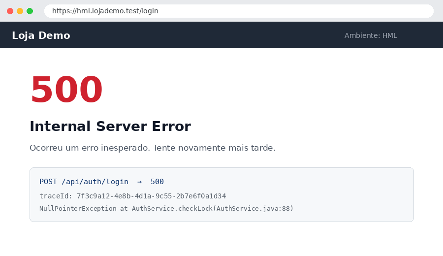

# BUG-001 — Erro 500 ao entrar com usuário bloqueado

## Resumo

Ao tentar entrar com um usuário **bloqueado**, a API de login responde **500** em vez da mensagem "Usuário bloqueado". Encontrado ao executar [[TC-002]].

## Ambiente

| Item | Valor |
| --- | --- |
| Ambiente | HML (hml.lojademo.test) |
| Browser / dispositivo | Chrome 128 — Windows 11 |
| Versão | 2.14.0 (build 1432) |
| Usuário / perfil | bloqueado@lojademo.test (cliente) |

## Passos para reproduzir

1. Bloquear o usuário `bloqueado@lojademo.test` no painel administrativo
2. Acessar https://hml.lojademo.test/login
3. Informar o usuário bloqueado e a senha correta
4. Clicar em **Entrar**

## Resultado esperado

Mensagem "Usuário bloqueado. Fale com o suporte." na própria tela de login, sem erro técnico.

## Resultado obtido

> [!CAUTION]
> Página de erro **500 — Internal Server Error**. A chamada `POST /api/auth/login` retorna 500 e o log do servidor mostra `NullPointerException` em `AuthService.checkLock`.

## Evidências



Resposta da API:

```json
{
  "status": 500,
  "error": "Internal Server Error",
  "path": "/api/auth/login",
  "traceId": "7f3c9a12-4e8b-4d1a-9c55-2b7e6f0a1d34"
}
```

Log do servidor (recolhido — clique para abrir):

```log collapsed
2026-09-24 14:36:01.912 INFO  [http-nio-8080-exec-7] AuthController - POST /api/auth/login user=bloqueado@lojademo.test
2026-09-24 14:36:01.915 DEBUG [http-nio-8080-exec-7] AuthService - carregando usuário
2026-09-24 14:36:01.921 DEBUG [http-nio-8080-exec-7] AuthService - usuário encontrado id=8841 status=BLOQUEADO
2026-09-24 14:36:01.922 DEBUG [http-nio-8080-exec-7] AuthService - verificando bloqueio
2026-09-24 14:36:01.923 ERROR [http-nio-8080-exec-7] GlobalExceptionHandler - erro não tratado
java.lang.NullPointerException: Cannot invoke "java.time.Instant.isAfter(java.time.Instant)" because "lock.expiresAt" is null
	at com.lojademo.auth.AuthService.checkLock(AuthService.java:88)
	at com.lojademo.auth.AuthService.authenticate(AuthService.java:52)
	at com.lojademo.auth.AuthController.login(AuthController.java:31)
	at java.base/jdk.internal.reflect.DirectMethodHandleAccessor.invoke(DirectMethodHandleAccessor.java:103)
	at java.base/java.lang.reflect.Method.invoke(Method.java:580)
	at org.springframework.web.method.support.InvocableHandlerMethod.doInvoke(InvocableHandlerMethod.java:255)
	at org.springframework.web.method.support.InvocableHandlerMethod.invokeForRequest(InvocableHandlerMethod.java:188)
	at org.springframework.web.servlet.mvc.method.annotation.ServletInvocableHandlerMethod.invokeAndHandle(ServletInvocableHandlerMethod.java:118)
	at org.springframework.web.servlet.DispatcherServlet.doDispatch(DispatcherServlet.java:1089)
	at org.springframework.web.servlet.FrameworkServlet.service(FrameworkServlet.java:885)
	at jakarta.servlet.http.HttpServlet.service(HttpServlet.java:658)
2026-09-24 14:36:01.924 INFO  [http-nio-8080-exec-7] AuthController - resposta 500 em 12 ms
```

## Impacto

Todo usuário bloqueado vê uma página de erro e abre chamado no suporte. Bloqueio por **tempo indeterminado** (sem data de expiração) é o caso que quebra.

## Observações

> [!TIP]
> **Experimente:** **Copiar ▾ → Copiar para o Jira** e cole na descrição do bug no Jira; o editor avisa quais prints anexar. Ou **Copiar ▾ → Copiar para o Claude → Falhas** para pedir a análise da causa.
