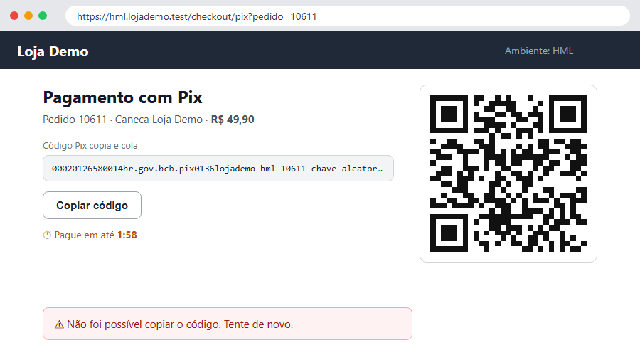

# TC-010 — Pagar com Pix pelo copia e cola

## Objetivo

O cliente paga com o **código copia e cola** (sem ler o QR Code) — o jeito mais usado no celular. Separado do [[TC-006]] a pedido da Ana na revisão: pagar pelo QR Code e pelo copia e cola são caminhos diferentes. Cobre o critério 1 da [[QA-410]].

## Pré-condições

- Pix ligado no backoffice e simulador do banco no ar (o **⏮ Antes da rodada** do [[COMP-001]] confere)
- Extensão do navegador do TestFlow instalada e a **captura de bug** ligada (`Ctrl+Shift+P` → *Captura de bug pela extensão*): se falhar, o bug já leva o console e a rede da aba

## Passos

| # | Ação | Resultado esperado | Resultado obtido | Status |
| --- | --- | --- | --- | --- |
| 1 | ↪ Fazer login (cliente) | Página inicial com "Olá" | Logado como cliente | `PASS` |
| 2 | Adicionar a "Caneca Loja Demo" ao carrinho, ir ao checkout, escolher **Pix** e clicar em **Gerar QR Code** | QR Code e o código copia e cola na tela | QR Code e código copia e cola exibidos (pedido 10688, com o cupom DEMO10) | `PASS` |
| 3 | Clicar em **Copiar código** | Aviso "Código copiado" e o código na área de transferência | Com o cupom DEMO10 no pedido, o aviso **Não foi possível copiar o código** voltou (Edge 141) | `FAIL` |
| 4 | Colar o código no simulador do banco ({{banco}}) e pagar | Em até 10 s, "Pagamento confirmado" e o pedido **Pago** | Sem o código copiado | `SKIP` |

🐞 Bug: [[BUG-004]] — Copiar código do Pix dá erro e não copia nada

## Evidências

## Observações

> [!TIP]
> Este caso mostra o **bug com captura**: quando o passo 3 falha, o 🐞 *Novo bug* leva o print do passo, o vídeo do **replay** e o **console e a rede** da aba (extensão do navegador). O bug ligado fica logo abaixo da tabela de passos; as rodadas, no *Histórico de execuções*. Criar o bug **não tira a aprovação**: é resultado da execução, não muda a definição do caso.

## Histórico de execuções

| Rodada | Data | Início | Fim | Duração | Ambiente | Resultado | Responsável |
| --- | --- | --- | --- | --- | --- | --- | --- |
| 1 | 10/10/2026 | 14:00 | 14:09 | 9 min | HML | `FAIL` | Lucas |
| 2 | 11/10/2026 | 16:00 | 16:06 | 6 min | HML | `PASS` | Lucas |
| 3 | 12/10/2026 | 10:00 | 10:11 | 11 min | HML | `FAIL` | Lucas |

### Rodada 1 — 11/10/2026 — `FAIL`

| # | Ação | Resultado esperado | Resultado obtido | Status |
| --- | --- | --- | --- | --- |
| 1 | ↪ Fazer login (cliente) | Página inicial com "Olá" | Logado como cliente | `PASS` |
| 2 | Adicionar a "Caneca Loja Demo" ao carrinho, ir ao checkout, escolher **Pix** e clicar em **Gerar QR Code** | QR Code e o código copia e cola na tela | QR Code e código copia e cola exibidos (pedido 10611) | `PASS` |
| 3 | Clicar em **Copiar código** | Aviso "Código copiado" e o código na área de transferência | Aviso **Não foi possível copiar o código**; nada na área de transferência (2 tentativas) | `FAIL` |
| 4 | Colar o código no simulador do banco ({{banco}}) e pagar | Em até 10 s, "Pagamento confirmado" e o pedido **Pago** | Sem o código copiado | `SKIP` |

### Rodada 2 — 12/10/2026 — `PASS`

| # | Ação | Resultado esperado | Resultado obtido | Status |
| --- | --- | --- | --- | --- |
| 1 | ↪ Fazer login (cliente) | Página inicial com "Olá" | Logado como cliente | `PASS` |
| 2 | Adicionar a "Caneca Loja Demo" ao carrinho, ir ao checkout, escolher **Pix** e clicar em **Gerar QR Code** | QR Code e o código copia e cola na tela | QR Code e código copia e cola exibidos (pedido 10652) | `PASS` |
| 3 | Clicar em **Copiar código** | Aviso "Código copiado" e o código na área de transferência | "Código copiado"; código colado no bloco de notas confere | `PASS` |
| 4 | Colar o código no simulador do banco ({{banco}}) e pagar | Em até 10 s, "Pagamento confirmado" e o pedido **Pago** | Confirmado em 4 s; pedido Pago | `PASS` |
