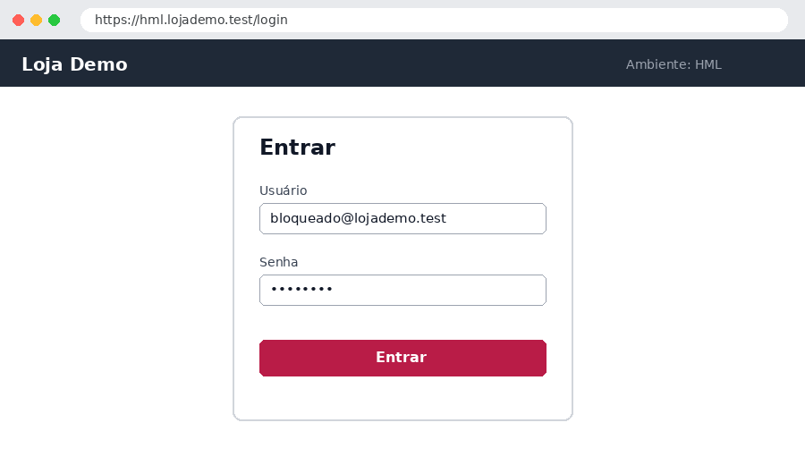
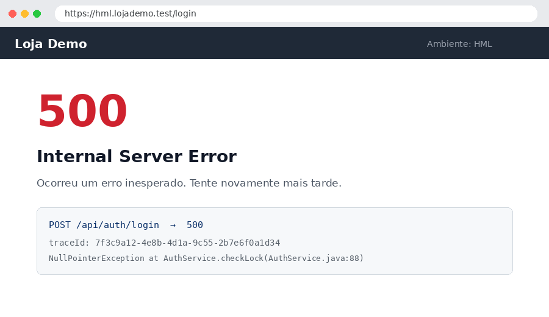

# TC-002 — Login com usuário bloqueado

## Objetivo

Um usuário bloqueado (5 tentativas erradas) não entra e vê uma mensagem clara, sem erro técnico.

## Pré-condições

- Usuário `bloqueado@lojademo.test` com status **Bloqueado** no painel administrativo

> [!IMPORTANT]
> O bloqueio é desfeito toda noite pela rotina de limpeza do HML — bloqueie de novo antes de executar.

## Massa de dados

| Campo | Valor |
| --- | --- |
| Usuário | bloqueado@lojademo.test |
| Senha | a senha correta do usuário |

## Passos

| # | Ação | Resultado esperado | Resultado obtido | Status |
| --- | --- | --- | --- | --- |
| 1 | Acessar /login | Tela de login exibida | Tela exibida | `PASS` |
| 2 | Informar o usuário bloqueado e a senha correta | Campos preenchidos | Como esperado | `PASS` |
| 3 | Clicar em **Entrar** | Mensagem "Usuário bloqueado. Fale com o suporte." | Página de erro 500 — ver [[BUG-001]] | `FAIL` |
| 4 | Conferir o log de auditoria | Tentativa registrada como "bloqueado" | Não foi possível: depende do passo 3 | `BLOCKED` |

## Evidências

## Observações

> [!CAUTION]
> Defeito aberto: [[BUG-001]]. Reexecutar quando a correção chegar no HML — use **🔁 Nova rodada** para guardar esta execução no histórico e começar outra.

## Histórico de execuções

| Rodada | Data | Início | Fim | Duração | Ambiente | Resultado | Responsável |
| --- | --- | --- | --- | --- | --- | --- | --- |
| 1 | 23/09/2026 | 10:05 | 10:14 | 9 min | HML | `FAIL` | Lucas |

### Rodada 1 — 23/09/2026 — `FAIL`

| # | Ação | Resultado esperado | Resultado obtido | Status |
| --- | --- | --- | --- | --- |
| 1 | Acessar /login | Tela de login exibida | Tela exibida | `PASS` |
| 2 | Informar o usuário bloqueado e a senha correta | Campos preenchidos | Como esperado | `PASS` |
| 3 | Clicar em **Entrar** | Mensagem "Usuário bloqueado. Fale com o suporte." | Tela ficou carregando e deu timeout | `FAIL` |
| 4 | Conferir o log de auditoria | Tentativa registrada como "bloqueado" | Não executado | `SKIP` |
