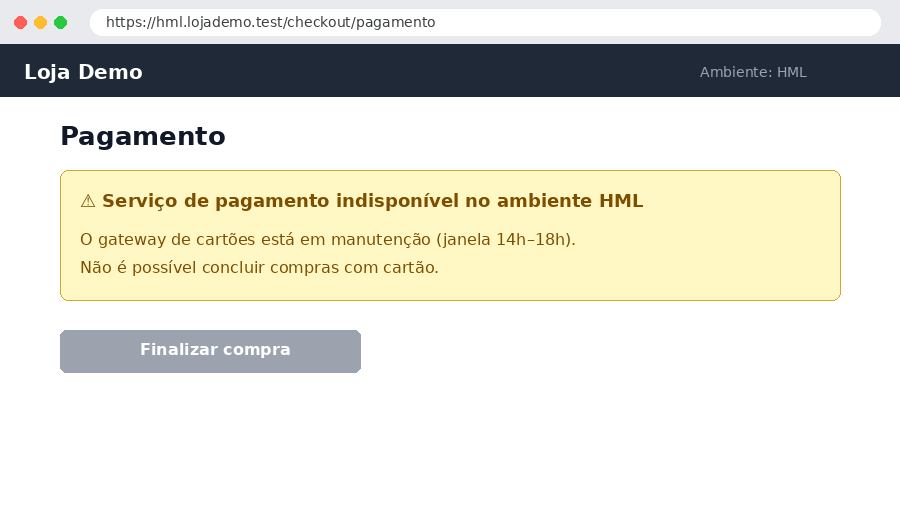

# TC-004 — Checkout com cartão de crédito

## Objetivo

Concluir uma compra pagando com cartão de crédito à vista.

## Pré-condições

- Cliente logado com endereço cadastrado
- Produto "Caneca QA" com estoque

## Massa de dados

> [!WARNING]
> Dados **fictícios** de teste — servem para experimentar a **proteção de dados sensíveis**: use **Copiar ▾ → Copiar para o Jira** (ou exporte o PDF) e veja o editor oferecer mascarar CPF, e-mail e cartão antes de sair do editor.

| Campo | Valor |
| --- | --- |
| Cliente | Maria Teste |
| CPF | 529.982.247-25 |
| E-mail | maria.teste@lojademo.test |
| Cartão (sandbox) | 4111 1111 1111 1111 |
| Validade / CVV | 12/30 / 123 |

## Passos

| # | Ação | Resultado esperado | Resultado obtido | Status |
| --- | --- | --- | --- | --- |
| 1 | Adicionar "Caneca QA" ao carrinho | Carrinho com 1 item | Como esperado | `PASS` |
| 2 | Ir para o pagamento e escolher **Cartão de crédito** | Formulário do cartão exibido | Como esperado | `PASS` |
| 3 | Preencher os dados do cartão e **Finalizar compra** | Pedido confirmado com número | Gateway de pagamento em manutenção no HML | `BLOCKED` |
| 4 | Conferir o e-mail de confirmação | E-mail com o resumo do pedido | Depende do passo 3 | `BLOCKED` |

## Evidências

## Observações

Bloqueio de ambiente (não é defeito do produto). Reexecutar depois da janela de manutenção do gateway.
