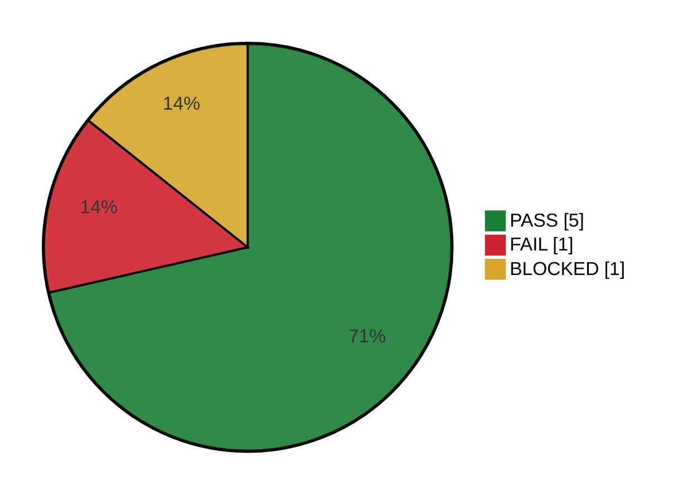

# EXE-001 — Regressão — Sprint 42

## Resumo

<!-- qa:resumo -->

**Executados:** 7 de 7 (100%) · **Status geral:** `FAIL`

| Status | Qtde | % |
| --- | ---: | ---: |
| `PASS` | 5 | 71% |
| `FAIL` | 1 | 14% |
| `BLOCKED` | 1 | 14% |
| `SKIP` | 0 | 0% |
| `PENDING` | 0 | 0% |
| **Total** | 7 | 100% |

<!-- /qa:resumo -->

> [!TIP]
> O bloco acima é o **resumo automático**: contagem por status + gráfico. Ele se atualiza sozinho quando você muda um status na tabela abaixo (clique na célula) e ao salvar. Clique em **FAIL** na barra *Execução* para ver só as linhas com falha.

## Resultados

| ID | Cenário | Status | Bug | Observação |
| --- | --- | --- | --- | --- |
| [[TC-001]] | Login com usuário e senha válidos | `PASS` | | |
| [[TC-002]] | Login com usuário bloqueado | `FAIL` | [[BUG-001]] | Erro 500 |
| [[TC-003]] | Recuperar senha por e-mail | `PASS` | | |
| [[TC-004]] | Checkout com cartão de crédito | `BLOCKED` | | Gateway em manutenção no HML |
| [[CEN-001]] | Carrinho — adicionar produto | `PASS` | | |
| [[CEN-001]] | Carrinho — alterar quantidade | `PASS` | | |
| [[CEN-001]] | Carrinho — cupom de desconto | `PASS` | | Cupons não cadastrados no HML |

## Defeitos encontrados

| Bug | Resumo | Severidade | Status |
| --- | --- | --- | --- |
| [[BUG-001]] | Erro 500 ao entrar com usuário bloqueado | Alta | Aberto |

## Bloqueios

> [!WARNING]
> [[TC-004]] bloqueado: gateway de pagamento em manutenção no HML das 14h às 18h. Reexecutar amanhã cedo.

## Observações

- Os links `[[TC-002]]`, `[[BUG-001]]`… abrem o documento (com a pasta `exemplos` aberta como pasta de trabalho).
- Na aba **Links** da barra lateral aparece quem cita este relatório.
