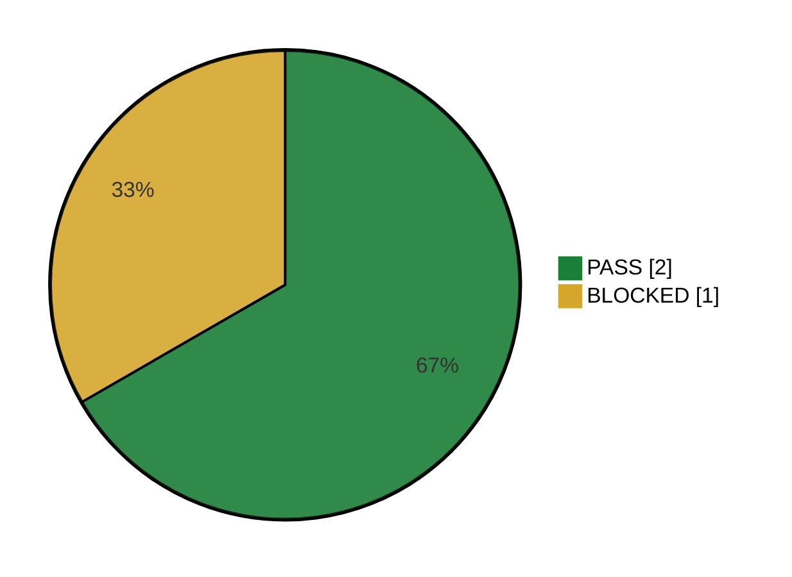

# Regressão do Pix — Execução #1

Execução #1 do ciclo [[CICLO-20260923-1030]] com 3 caso(s) (ciclo Regressão do Pix), iniciada em 24/09/2026 às 14:00. O status de cada caso vem da execução dele (▶ Executar → ✓ Concluir); **▶ Próximo caso** abre o próximo pendente. Status marcado à mão aqui (ex.: `SKIP`) fica. O relatório de testes automatizados (🤖) entra na seção "Testes automatizados", separado dos manuais.

<!-- qa:resumo -->

**Executados:** 3 de 3 (100%) · **Status geral:** `BLOCKED`

| Status | Qtde | % |
| --- | ---: | ---: |
| `PASS` | 2 | 67% |
| `FAIL` | 0 | 0% |
| `BLOCKED` | 1 | 33% |
| `SKIP` | 0 | 0% |
| `PENDING` | 0 | 0% |
| **Total** | 3 | 100% |

<!-- /qa:resumo -->

## Casos do ciclo

| # | Caso | Título | Status | Executado em | Bugs |
| --- | --- | --- | --- | --- | --- |
| 1 | [[TC-005]] | Pagar com Pix pelo QR Code | `PASS` | 24/09/2026 14:17 | |
| 2 | [[TC-006]] | QR Code do Pix expirado não aceita pagamento | `PASS` | 24/09/2026 14:29 | |
| 3 | [[TC-008]] | Atendente estorna um pedido pago com Pix | `BLOCKED` | 24/09/2026 14:39 | |

## Encerramento

Encerrado em 24/09/2026 às 14:45 — resultado `BLOCKED`: 2 PASS · 0 FAIL · 1 BLOCKED · 0 SKIP.

**Falhas e bloqueios:**

- [[TC-008]] `BLOCKED`
