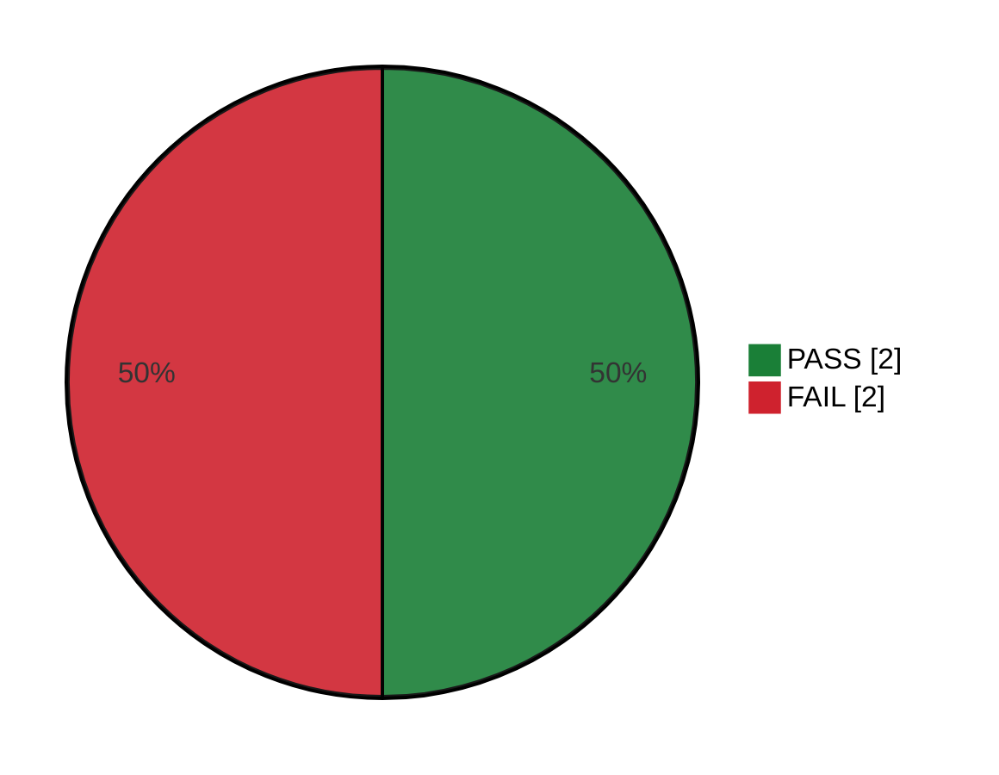

# Regressão do Pix — Execução #2

Execução #2 do ciclo [[CICLO-20260923-1030]] com 4 caso(s) (ciclo Regressão do Pix), iniciada em 01/10/2026 às 08:30. O status de cada caso vem da execução dele (▶ Executar → ✓ Concluir); **▶ Próximo caso** abre o próximo pendente. Status marcado à mão aqui (ex.: `SKIP`) fica. O relatório de testes automatizados (🤖) entra na seção "Testes automatizados", separado dos manuais.

<!-- qa:resumo -->

**Executados:** 4 de 4 (100%) · **Status geral:** `FAIL`

| Status | Qtde | % |
| --- | ---: | ---: |
| `PASS` | 2 | 50% |
| `FAIL` | 2 | 50% |
| `BLOCKED` | 0 | 0% |
| `SKIP` | 0 | 0% |
| `PENDING` | 0 | 0% |
| **Total** | 4 | 100% |

<!-- /qa:resumo -->

## Casos do ciclo

| # | Caso | Título | Status | Executado em | Bugs |
| --- | --- | --- | --- | --- | --- |
| 1 | [[TC-005]] | Pagar com Pix pelo QR Code | `PASS` | 01/10/2026 08:51 | |
| 2 | [[TC-006]] | QR Code do Pix expirado não aceita pagamento | `FAIL` | 01/10/2026 09:07 | [[BUG-002]] |
| 3 | [[TC-007]] | Limites de valor do Pix | `PASS` | 01/10/2026 09:40 | |
| 4 | [[TC-008]] | Atendente estorna um pedido pago com Pix | `FAIL` | 01/10/2026 10:03 | [[BUG-003]] |

## Encerramento

Encerrado em 01/10/2026 às 10:30 — resultado `FAIL`: 2 PASS · 2 FAIL · 0 BLOCKED · 0 SKIP.

**Falhas e bloqueios:**

- [[TC-006]] `FAIL` — [[BUG-002]]
- [[TC-008]] `FAIL` — [[BUG-003]]

**Bugs abertos ligados:** [[BUG-002]], [[BUG-003]]

## Relatórios

Gerados em 01/10/2026 às 10:30 (📑 Relatórios regera; o que você escrever nos trechos de comentário e aceite fica).

- 🏁 [[EXEC-20261001-083000-ENC]] — Encerramento e Go/No-Go
- 🐞 [[EXEC-20261001-083000-DEF]] — Defeitos da rodada
- 🧭 [[EXEC-20261001-083000-RAS]] — Rastreabilidade e cobertura
- 📜 [[EXEC-20261001-083000-LOG]] — Log da execução e comparativo
