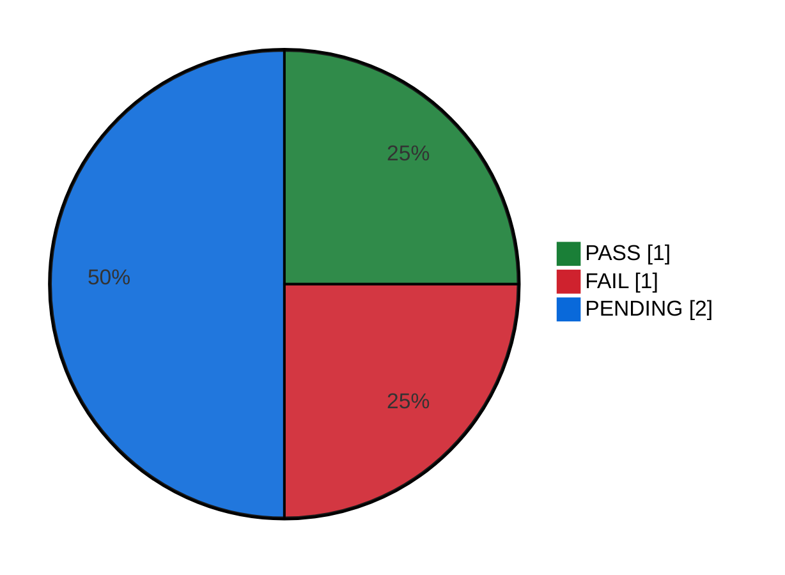

# Regressão do Pix — Execução #3

Execução #3 do ciclo [[CICLO-20260923-1030]] com 4 caso(s) (ciclo Regressão do Pix), iniciada em 08/10/2026 às 08:45. O status de cada caso vem da execução dele (▶ Executar → ✓ Concluir); **▶ Próximo caso** abre o próximo pendente. Status marcado à mão aqui (ex.: `SKIP`) fica. O relatório de testes automatizados (🤖) entra na seção "Testes automatizados", separado dos manuais.

<!-- qa:resumo -->

**Executados:** 2 de 4 (50%) · **Status geral:** `FAIL`

| Status | Qtde | % |
| --- | ---: | ---: |
| `PASS` | 1 | 25% |
| `FAIL` | 1 | 25% |
| `BLOCKED` | 0 | 0% |
| `SKIP` | 0 | 0% |
| `PENDING` | 2 | 50% |
| **Total** | 4 | 100% |

<!-- /qa:resumo -->

## Casos do ciclo

| # | Caso | Título | Status | Executado em | Bugs | Testador |
| --- | --- | --- | --- | --- | --- | --- |
| 1 | [[TC-005]] | Pagar com Pix pelo QR Code | `PASS` | 08/10/2026 09:14 | | Ana |
| 2 | [[TC-006]] | QR Code do Pix expirado não aceita pagamento | `FAIL` | 08/10/2026 09:16 | [[BUG-002]] | Bruno |
| 3 | [[TC-007]] | Limites de valor do Pix |  | em andamento (1/3 iterações) | | Lucas |
| 4 | [[TC-008]] | Atendente estorna um pedido pago com Pix |  | em andamento | [[BUG-003]] | Ana |
