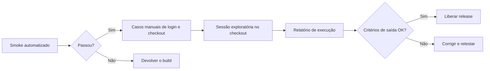
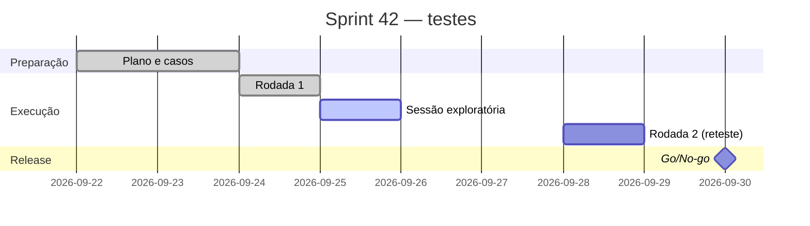

# PT-001 — Plano de teste — Sprint 42

## Objetivo

Validar as mudanças de **login** (bloqueio de usuário) e **checkout** (novo gateway de cartão) da versão 2.14.0 antes da release de 30/09.

## Escopo

- Login: bloqueio após 5 tentativas, mensagem de usuário bloqueado — [[TC-002]]
- Recuperação de senha — [[TC-003]]
- Checkout com cartão no gateway novo — [[TC-004]]
- Carrinho (regressão) — [[CEN-001]]

## Fora de escopo

- App mobile
- Relatórios administrativos

## Estratégia

> [!NOTE]
> Diagramas Mermaid: duplo clique amplia; os botões no canto exportam SVG ou copiam o código. Para editar, clique no bloco (ou no `</>`).

## Ambientes

| Ambiente | URL | Dados |
| --- | --- | --- |
| HML | https://hml.lojademo.test | massa de teste renovada toda noite |
| STG | https://stg.lojademo.test | cópia anonimizada de produção |

## Critérios de entrada

- [x] Build 2.14.0 publicado no HML
- [x] Smoke automatizado verde
- [ ] Gateway de cartão configurado no HML

## Critérios de saída

- [ ] Nenhum bug Crítico ou Alto aberto
- [ ] 100% dos casos de login e checkout executados
- [ ] Sessão exploratória do checkout concluída

## Riscos

| Risco | Probabilidade | Impacto | Mitigação |
| --- | --- | --- | --- |
| Gateway instável no HML | Alta | Alto | Janela de testes com o time de pagamentos |
| Massa de dados apagada à noite | Média | Médio | Script de recarga antes de cada rodada |

## Cronograma

## Responsáveis

| Papel | Pessoa |
| --- | --- |
| QA líder | Lucas |
| QA | Ana |
| Dev de referência (login) | Bruno |
