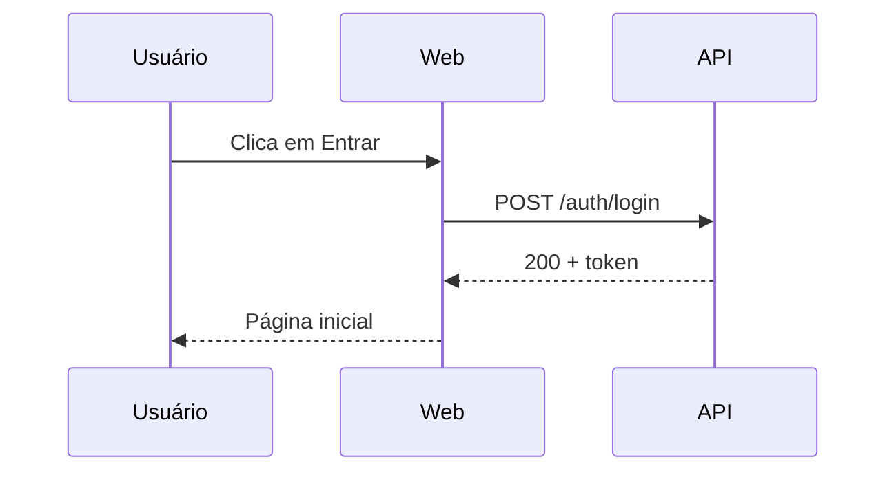
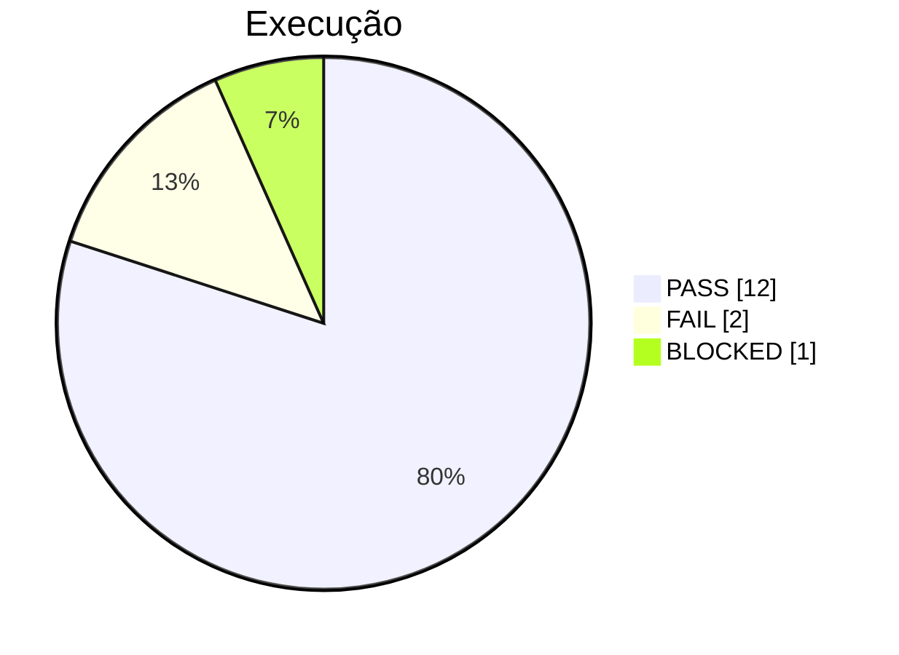
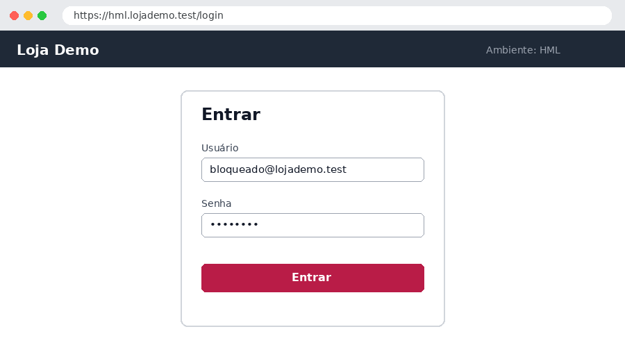

# Tour do Markdown no editor

Tudo o que o editor sabe mostrar — e como fica no arquivo. Abra em **Dividido** (`Alt+2`) para ver o Markdown (esquerda) e o resultado (direita) lado a lado.

> [!TIP]
> Clique em qualquer bloco à direita para editar direto no visual. `Esc` cancela, clicar fora (ou `Ctrl+Enter`) aplica. `Alt+clique` num bloco leva à linha no Raw.

## Texto

Texto em **negrito**, *itálico*, ~~tachado~~, `código inline`, [link](https://example.com) e URL solta: https://example.com.

Com cor: <span style="color:#cf222e">vermelho</span>, <span style="color:#1a7f37">verde</span> — toolbar **Cor**. Use com moderação: o significado deve estar no texto, não só na cor.

Tecla: <kbd>Ctrl</kbd> + <kbd>S</kbd> · marca-texto: <mark>importante</mark> · H<sub>2</sub>O · 10<sup>3</sup>.

## Status (badges)

`PASS` `FAIL` `BLOCKED` `SKIP` `PENDING` — e sinônimos: `OK` `NOK` `BLOQUEADO` `PENDENTE` `N/A`.

Toolbar **Status ▾**, `/fail`, ou digite a palavra entre crases.

## Caixas de destaque

> [!NOTE]
> Contexto, informação de ambiente.

> [!TIP]
> Boa prática, dica de reprodução.

> [!IMPORTANT]
> Pré-condição crítica, dependência.

> [!WARNING]
> Risco, limitação, dado sensível.

> [!CAUTION]
> Defeito encontrado, bloqueio.

Citação comum:

> O que não é medido não é gerenciado.

## Listas e checklist

- Item
  - Subitem
- Outro item

1. Primeiro
2. Segundo

- [x] Tarefa feita
- [ ] Tarefa pendente (clique na caixinha)

## Tabela

| Coluna à esquerda | Centralizada | À direita | Resultado |
| :--- | :---: | ---: | --- |
| texto | texto | 1.234,56 | `PASS` |
| quebra<br>de linha | `código` | 10 | `FAIL` |

Ao editar: barra para inserir/mover/excluir linhas e colunas, `Tab` entre células, `Shift+Enter` quebra linha na célula. Passe o mouse → **XLSX** / **CSV** exporta.

## Blocos de código

Toolbar **{ } Código ▾** (escolha a linguagem) ou `Ctrl+Alt+K`:

```json
{ "usuario": "qa_user", "ativo": true, "perfis": ["cliente"] }
```

```bash
npx playwright test tests/e2e/login.spec.ts --project=chromium
```

```sql
SELECT id, email, status FROM usuarios WHERE status = 'BLOQUEADO';
```

```http
POST /api/auth/login HTTP/1.1
Content-Type: application/json
```

Log longo **recolhido** (`log collapsed`) — clique no título para abrir:

```log collapsed
2026-09-26 10:00:01 INFO  inicio da rotina
2026-09-26 10:00:02 INFO  lendo 120 registros
2026-09-26 10:00:03 WARN  registro 57 sem e-mail
2026-09-26 10:00:04 INFO  fim da rotina (119 ok, 1 aviso)
```

## Diagramas (Mermaid)





## Imagens

O texto entre colchetes vira **legenda** embaixo da imagem:



Prints: cole com `Ctrl+V` — o editor salva em `evidencias/` ao lado do `.md` e abre o editor de anotação (seta, retângulo, texto, borrar).

## Links entre documentos

[[TC-002]] · [[BUG-001|o bug do login]] · [[TC-999]] (não existe: fica tracejado).

Link para o VS Code (abre o arquivo na linha): <a href="vscode://file/C:/dev/projeto/tests/e2e/login.spec.ts:12">login.spec.ts:12</a> — o relatório de automação gera esses links sozinho.

## Separador

---

Fim do tour. Veja também [[RES-001]] (resumo) e o manual (`MANUAL.md`, na raiz do projeto — ou **?** no topo do editor).
