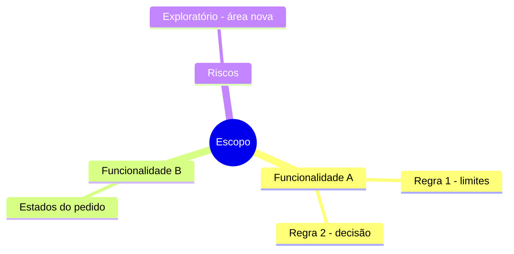

# PT-000 — Plano de teste — Projeto / Release

## Objetivo

## Escopo

- 

## Fora de escopo

- 

## Mapa de cobertura

## Estratégia

| Tipo de teste | Abordagem | Técnicas | Ferramenta |
| --- | --- | --- | --- |
| Funcional manual | Casos de teste + exploratório | partição, limites, tabela de decisão, estados | TestFlow |
| Regressão automatizada | E2E | — | Playwright |
| API | Contratos e cenários negativos | partição, suposição de erro | Postman/Newman |

## Ambientes

| Ambiente | URL | Observação |
| --- | --- | --- |
| HML | | |

## Critérios de entrada

- [ ] Build disponível em HML
- [ ] Massa de dados preparada

## Critérios de saída

- [ ] 100% dos casos críticos executados
- [ ] Nenhum bug crítico ou alto em aberto

## Riscos

| Risco | Probabilidade | Impacto | Resposta | Mitigação |
| --- | --- | --- | --- | --- |
| | | | mitigar · aceitar · transferir · contingência | |

## Cronograma

| Atividade | Início | Fim | Responsável |
| --- | --- | --- | --- |
| | | | |

## Estimativa

| Tarefa de teste | Otimista (o) | Mais provável (m) | Pessimista (p) | Estimativa (o + 4m + p) ÷ 6 |
| --- | --- | --- | --- | --- |
| | | | | |

> [!NOTE]
> Estimativa de três pontos: some as tarefas; margem ± (p − o) ÷ 6. Com histórico, compare com a média das últimas rodadas parecidas.

## Responsáveis
