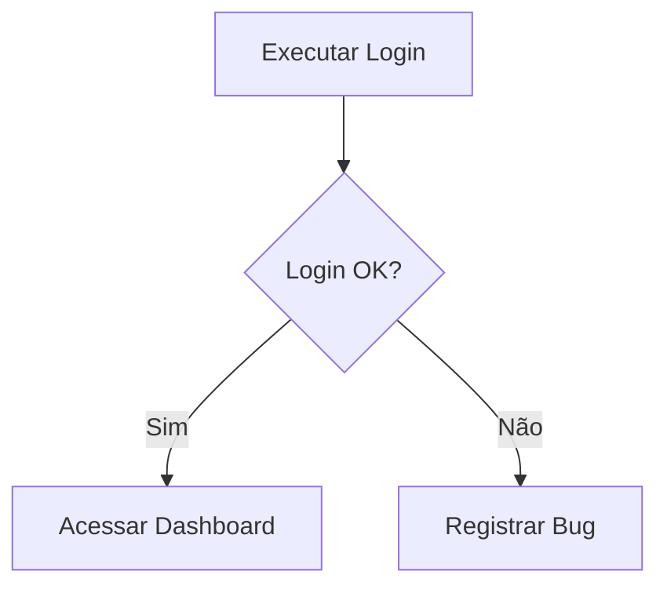

# Test Case: Login

Bem-vindo ao **TestFlow**. Clique em qualquer texto aqui no Preview para editá-lo diretamente — ou use o modo **Raw** para editar o Markdown puro.

## Pré-condições

- Usuário cadastrado
- Ambiente de homologação disponível

## Steps

1. Acessar a aplicação
2. Informar usuário
3. Informar senha
4. Clicar em Login

## Resultado esperado

Usuário deve ser direcionado para o Dashboard.

## Resultado obtido

O teste foi executado com sucesso.

- Login: <span style="color:#188038">OK</span>
- Cadastro: <span style="color:#188038">OK</span>
- Logout: <span style="color:#d93025">**NOK**</span>

## Checklist

- [x] Login com usuário válido
- [x] Mensagem de erro com senha inválida
- [ ] Bloqueio após 5 tentativas

## Execução

| Cenário | Browser | Status |
| --- | --- | :---: |
| Login válido | Chrome 128 | `PASS` |
| Login inválido | Firefox 130 | `PASS` |
| Logout | Edge 128 | `FAIL` |

> [!TIP]
> Clique num status da tabela para trocá-lo (teclas **1–5** e o seletor desce para a próxima linha). A barra **Execução**, no topo do Preview, mostra o progresso e filtra por status.

> [!CAUTION]
> Logout retorna erro 500 no Edge — bug a registrar no Jira.

## Fluxo



## Evidência (automação)

```js
test('login válido', async ({ page }) => {
  await page.goto('/login');
  await page.fill('#user', 'qa_user');
  await page.click('button[type=submit]');
  await expect(page).toHaveURL(/dashboard/);
});
```

> [!TIP]
> Cole prints com `Ctrl+V`, tabelas direto do Excel e JSON/logs de API — o editor formata sozinho. **Status** e **Destaque** estão na toolbar, **A−/A+** ajusta o tamanho do texto e **PDF** exporta o documento.
